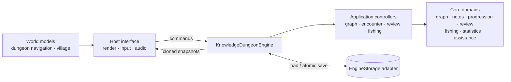

# Knowledge Dungeon Engine

[](LICENSE)
[](package.json)
[](package.json)

A headless TypeScript engine for Knowledge Dungeon, extracted from
[Knowledge Dungeon](https://github.com/McFuzzySquirrel/knowledge-dungeon) at
commit `87c346ae7894af903ca7a514eef2badbcf32e810`. It does not depend on React,
Pixi, Phaser, Electron, or a particular interface. A host supplies presentation,
input, and long-term storage.

The package contains topic graphs and dungeon generation; Creator, Scribe and
Archaeologist commands; note validation, artifacts, review scheduling,
progression, loot, equipment, achievements and statistics; fishing rules and
commands; village data, quests, NPC movement, and dungeon/village navigation.
The host drives movement and fishing state-machine ticks and presents results.

## Table of Contents

- [About](#about)
- [Features](#features)
- [Tech Stack](#tech-stack)
- [Architecture](#architecture)
- [Project Structure](#project-structure)
- [Reference Host](#reference-host)
- [Getting Started](#getting-started)
- [Configuration](#configuration)
- [Security](#security)
- [How to Contribute](#how-to-contribute)
- [What's Next](#whats-next)
- [License](#license)
- [Acknowledgements](#acknowledgements)
- [Author](#author)

## About

Knowledge Dungeon Engine implements the rules of a note-taking dungeon game:
a learner maps a subject into a topic graph, clears rooms by writing structured
notes, collects artifacts, reviews rooms on a spaced schedule, and fishes for
rewards tied to what they have learned. The engine owns those rules and the
state they produce. It does not own the screen, the input device, or the
database.

This is a headless engine for Knowledge Dungeon, not a general-purpose game
physics engine. Its included dungeon movement and collision model is grid-based;
it does not implement platformer mechanics such as gravity or jumping. A
side-scrolling interface can still use the learning and progression rules, but
would supply its own movement and collision behavior.

**Documentation:** [User guide](docs/user-guide.md) · [Host UI guide](docs/host-ui-guide.md) · [Administrator guide](docs/admin-guide.md) · [ADR index](docs/adr/README.md) · [Release notes](docs/releases/0.1.0.md) · [Changelog](CHANGELOG.md)

## Features

| Capability | What it does |
| --- | --- |
| Subjects and graph | Creates subjects and root rooms; adds child topics, cross-links, reparenting, removal, and tags. |
| Note validation | Requires `Summary`, `Key Points`, and `Recall Question` plus learner confirmation; scores a five-criterion rubric and generates artifact markdown. |
| Progression | Awards XP, rank tiers, loot, equipment, phase badges, the 120-word Scribe badge, and cross-subject achievements once per clear. |
| Spaced review | Schedules rooms with SM-2, validates explicit 0–5 ratings, and persists save/resume/discard decisions for unfinished reviews. |
| Fishing | Drives a pure cast/bite/reel state machine, rolls a catalogued fish from a seeded stream, and commits keep/release with recall-dependent rewards. |
| Dungeon world | Generates a deterministic grid layout from the graph, computes floor visibility, collision, room travel, and a 120-second teleport cooldown. |
| Village world | Provides the village map, structures, NPC paths, proximity selection, subject portals, the guild hall, and the training gate. |
| Study sessions | Records start, activity, end, unique room visits, and recovery at last activity. |
| Statistics | Computes local-calendar metrics from an idempotent event ledger. |
| Learner assistance | Ranks deterministic study suggestions in `off`, `gentle`, and `standard` modes. |
| Storage contract | Persists one versioned `EngineState` through an atomic host-supplied adapter. |

## Tech Stack

| Layer | Choice | Version |
| --- | --- | --- |
| Language | TypeScript, strict mode | `^5.6.3` |
| Runtime | Node.js | `>=20` |
| Target | ES2022 (`ESNext` modules) | — |
| Build | tsup (ESM + declarations) | `^8.5.0` |
| Tests | Vitest | `^4.1.6` |
| Runtime dependencies | None | — |
| Storage | Host-supplied `EngineStorage` | — |

## Architecture



The facade serializes commands, clones state at every boundary, and commits
through the storage adapter. Controllers translate tagged commands into domain
operations. Core domains are renderer-neutral and testable in Node. World models
are exported directly for hosts that drive movement themselves.

The architectural decisions and their consequences are recorded in the
[ADR index](docs/adr/README.md). Start with
[ADR-0001](docs/adr/0001-headless-renderer-neutral-engine.md) for the renderer
boundary and [ADR-0002](docs/adr/0002-versioned-atomic-engine-state.md) for the
storage contract.

## Project Structure

```
src/
  index.ts                     Public namespace and type exports
  creatorEngine.ts             KnowledgeDungeonEngine facade
  storage.ts                   EngineState, EngineStorage, MemoryEngineStorage
  learningPorts.ts             Scribe/review ports wired into engine state
  fishingPorts.ts              Fishing ports wired into engine state
  session.ts                   Study phase, quest step, and world state
  studySessions.ts             Study-session start, activity, and recovery
  achievements.ts              Cross-subject achievement updates
  application/                 Command contracts, controllers, session lifecycle
  core/                        Graph, notes, progression, review, fishing, layout,
                               artifacts, assistance, statistics, persistence
  world/                       Dungeon walkability/navigation and village movement
  data/                        Village layout and tutorial subject
  content/                     Player archetypes
tests/                         Unit and phase tests for commands, rules, and world
scripts/                       Local Markdown index and MCP documentation-search tooling
docs/                          User guide, host UI guide, administrator guide, ADRs, release notes
examples/side-scroller/        Reference side-view host (own package, tests, and plan)
.github/workflows/             Pages deploy for reference-example branches
```

## Reference Host

[`examples/side-scroller/`](examples/side-scroller/README.md) is a complete, playable
host built on the engine: a side-view village street above a generated dungeon, Canvas
2D rendering, IndexedDB persistence, and the Creator/Scribe/Archaeologist loop. It is
standalone (its own `package.json`, lockfile, TypeScript config, and Vitest suite) and
strictly additive — it changes no engine source, export, schema, or runtime dependency.
A hosted copy is at
[`mcfuzzysquirrel.github.io/knowledge-dungeon-engine/examples/side-scroller/`](https://mcfuzzysquirrel.github.io/knowledge-dungeon-engine/examples/side-scroller/).

```sh
npm --prefix examples/side-scroller install
npm --prefix examples/side-scroller run dev
```

Use it to see how the commands in the [host UI guide](docs/host-ui-guide.md) fit
together in a real screen flow. Its
[boundary rules](docs/plans/side-scroller-host/ENGINE-BOUNDARY.md) record what stays in
the engine, and the [implementation plan](docs/plans/side-scroller-host/README.md) and
[visual record](docs/plans/side-scroller-host/VISUALS.md) document each phase. It is a
reference, not a published package: the root test suite remains engine-only and does
not discover `examples/**`. The example is complete through P10 and ships a local gate
(`node examples/side-scroller/scripts/gate.mjs`). Hosting follows
[ADR-0011](docs/adr/0011-github-pages-reference-examples.md): each `examples/*` branch
publishes its built `dist` under one GitHub Pages site, while the full engine + example
gate remains local.

## Getting Started

Requires Node.js 20 or newer to build. The built ES module also runs in modern
browsers with `structuredClone`, `Blob`, and ES2022 support.

```sh
npm install
npm test
npm run typecheck
npm run build
```

`npm install` also runs the `prepare` script, which builds the package. Run
`npm test` to verify the checkout.

Consumers can install the Git repository; the `prepare` script builds the
package when installed from Git.

```sh
npm install github:McFuzzySquirrel/knowledge-dungeon-engine
```

### A headless learning loop

```ts
import { KnowledgeDungeonEngine, MemoryEngineStorage, dungeonNavigation } from 'knowledge-dungeon-engine';

const storage = new MemoryEngineStorage();
const engine = await KnowledgeDungeonEngine.open({
  storage,
  nowIso: () => new Date().toISOString(),
  newRoomId: () => crypto.randomUUID(),
});

const created = await engine.createSubject({
  dungeonId: 'math',
  subjectName: 'Mathematics',
  rootRoomId: 'root',
  rootTopic: 'Mathematics',
  nowIso: new Date().toISOString(),
});
if (!created.ok) throw new Error(created.error.message);

await engine.dispatchGraph({
  type: 'graph/children-add',
  payload: { parentRoomId: 'root', topics: ['Algebra'] },
});
const submitted = await engine.submitNote({
  roomId: 'root',
  noteText: 'Summary\nAn overview.\nKey Points\n- A point.\nRecall Question\nWhy?',
  manualConfirmed: true,
});
if (!submitted.ok) throw new Error(submitted.error.message);
if (submitted.value.kind === 'cleared') await engine.collectArtifact('root');

const snapshot = engine.snapshot();
const navigation = dungeonNavigation.createDungeonNavigation(snapshot.subjects.math.dungeon);
const worldState = navigation.move({ x: 1, y: 0 }, 16);
```

`engine.subscribe(listener)` receives a cloned state after each successful
commit; its return value unsubscribes. `snapshot()` also returns an isolated
copy. Commands that return `{ ok: false }` are refusals; storage and other
unexpected failures reject. The optional `onListenerError` reports subscriber
failures without rolling back an already committed state.

The engine exposes `dispatchEncounter` for attachments, `dispatchReview` for
review and interrupted sessions, `dispatchFishing` for pond commands,
`equipItem`/`unequipItem`, `activateSubject`, `startTutorial`,
`interactVillageStructure`, and quest/session methods. `villageStructures()`
provides structures including subject portals. The `world`, `dungeonNavigation`,
`villageWorld`, `villageInteractions`, `fishingState`, `fishingMechanics`, and
other exported namespaces provide host-independent models and rules.

For fishing, begin a session for a subject with `fishing/session-begin`, drive
`fishingState.createFishingState` and `fishingState.reduceFishing` with the
host's clock and random stream, and send the resulting cast, bite and keep or
release commands through `dispatchFishing`. The command interface assumes the
host sends results from the state machine; it is not an anti-cheat boundary.
Fishing requires at least one cleared room and uses the selected session's
subject for eligibility, recall, and rewards.

`dungeonNavigation` provides position, visible floors, collision, room travel
and the map-teleport cooldown. Recreate it when the subject graph changes.
`villageWorld` supplies player and NPC movement and proximity selection; a host
decides how to display and invoke the reported interactions.

Study-session records are in `snapshot().studySessions`. Creating or activating
a subject starts a session; returning to the village closes it. Call
`recordRoomVisit(roomId)` when navigation enters a room; awarded notes, reviews
and fishing XP are counted automatically. A host should call
`endStudySession()` on exit. On recovery after an interrupted host, call
`endStudySession(true)` to close the unfinished session at its last activity,
then `activateSubject` to start another. A `newStudySessionId` option can be
injected for deterministic tests.

## Configuration

The library reads no environment variables and has no configuration file.
Configuration is the options object passed to `KnowledgeDungeonEngine.open()`:

| Option | Required | Default | Purpose |
| --- | --- | --- | --- |
| `storage` | Yes | — | `EngineStorage` adapter for the complete state. |
| `nowIso` | Yes | — | Current ISO-8601 timestamp. |
| `newRoomId` | Yes | — | Mints unique room ids. |
| `random` | No | `Math.random` | Stream in `[0, 1)` for loot and other rolls. |
| `newSessionId` | No | `crypto.randomUUID()` | Mints fishing-session ids. |
| `newStudySessionId` | No | `crypto.randomUUID()` | Mints study-session ids. |
| `newAttachmentId` | No | `crypto.randomUUID()` | Mints attachment ids. |
| `onListenerError` | No | Console error | Reports subscriber failures without rollback. |

The package is version `0.1.0`. The engine state is version `1`; the subject
schema is `1.1.0`. There is no migration from older Knowledge Dungeon saves.

### Storage contract

`MemoryEngineStorage` is volatile: keep the instance to reopen the same state,
but data disappears with the process. For durable saves, implement
`EngineStorage.load()` and `save(state)`. `save` must atomically replace the
whole state or reject without changing the prior state. Store the complete
`EngineState`, including `Uint8Array` attachment bytes, and preserve its
version. The engine serializes commands within one instance. Use only one
engine instance per adapter at a time: instances cache state independently.

Existing Knowledge Dungeon saves and backup files are **not compatible** with
this fresh engine state. There is no migration or persistent browser/Node
adapter included. Generated IDs must be unique; optional session and attachment
ID generators can be injected, otherwise `crypto.randomUUID()` is used. Inject
`random` to control loot rolls.

See the [administrator guide](docs/admin-guide.md#storage-and-backups) for the
full persisted-field list, atomicity requirements, and backup procedure.

## Security

The engine has no authentication, authorization, accounts, network client, or
secrets. It performs no network requests and collects no telemetry. Learner
content lives in the state your adapter persists, so encryption at rest, access
control, retention, deletion, and backup protection belong to the host. Use one
engine instance per adapter, treat attachment file names and external URLs as
untrusted when displaying them, and never place credentials in engine options or
state.

The full hardening checklist and the library's non-applicable security areas are
in the [administrator guide](docs/admin-guide.md#security-and-privacy-checklist).
Report security concerns through the repository's GitHub issue tracker without
including learner data or secrets.

## How to Contribute

There is no `CONTRIBUTING.md` yet. The workflow is:

1. Open an issue describing the behavior change or bug.
2. Fork the repository and create a focused branch.
3. Run `npm install`, then `npm test`, `npm run typecheck`, and `npm run build`.
4. Add or update tests for behavior changes. Keep the change scoped.
5. Open a pull request explaining what changed and why.

Keep the engine renderer-neutral: do not add React, Pixi, Phaser, Electron, DOM,
or network dependencies to the runtime. Durable design decisions should be
recorded as a new ADR in [`docs/adr/`](docs/adr/README.md) with one decision per
record.

## What's Next

These are known gaps and candidate work, **not shipped behavior**:

- Durable `EngineStorage` adapters for browsers and Node.
- A migration path from existing Knowledge Dungeon saves and backups.
- An npm release (the package is currently private and installed from Git).
- A repository-wide CI workflow; the Pages deploy workflow validates the example, while the engine suite and full gate remain local.
- Dedicated test coverage for the statistics and assistance modules.
- Additional reference hosts for other UI stacks. The completed
  [side-scroller example](examples/side-scroller/README.md) covers vanilla TypeScript,
  Vite, and Canvas 2D, including keyboard, touch, reduced motion, large text, and a
  local gate; there is no packaged host kit yet.
- Optional movement models beyond the grid, if a host needs platformer physics.

No timeline or commitment is implied. Check the issue tracker for current work.

## License

MIT. The original source and attribution are preserved in [LICENSE](LICENSE).

## Acknowledgements

- Extracted from [Knowledge Dungeon](https://github.com/McFuzzySquirrel/knowledge-dungeon) at commit `87c346ae7894af903ca7a514eef2badbcf32e810`.
- Original game design and implementation by McFuzzySquirrel.
- Built with TypeScript, tsup, Vitest, and `@types/node`.
- Review scheduling follows the SuperMemo 2 (SM-2) algorithm by Piotr Wozniak.

## Author

Maintainer: **McFuzzySquirrel**

- GitHub: [@McFuzzySquirrel](https://github.com/McFuzzySquirrel)
- Issues and questions: [knowledge-dungeon-engine/issues](https://github.com/McFuzzySquirrel/knowledge-dungeon-engine/issues)
