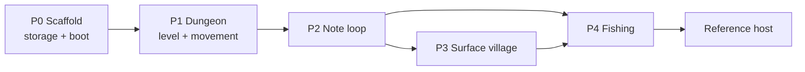

# Side-Scroller Host Example — Implementation Plan

| Field | Value |
|---|---|
| Plan version | 1.7 |
| Status | In progress — P0–P3 done (P3 polished 2026-11-24); P4 next |
| Created | 2026-11-23 |
| Owner | Unassigned |
| Phase documents | [P0](phase-0-scaffold.md) · [P1](phase-1-dungeon-level.md) · [P2](phase-2-note-loop.md) · [P3](phase-3-surface-village.md) · [P4](phase-4-fishing.md) |
| Evidence index | [EVIDENCE.md](EVIDENCE.md) |
| Visual record | [VISUALS.md](VISUALS.md) |
| Base commit | `3951737` (`Add project documentation and host UI guide`) |

This plan turns Knowledge Dungeon Engine into a small, playable side-scroller host
under `examples/side-scroller/`. It is additive: the engine's `src/`, published
exports, and storage contract do not change. Every phase has its own document with
task IDs, checklists, an exit gate, sub-agent opportunities, and an evidence log.

---

## 1. Purpose

The engine is headless and renderer-neutral
([README](../../../README.md#architecture),
[ADR-0001](../../adr/0001-headless-renderer-neutral-engine.md)). It deliberately
ships no screen, camera, assets, or save backend
([host guide](../../host-ui-guide.md#what-the-engine-gives-you)). The repository's
own gap list names "higher-level host packages or examples for common UI stacks" as
unshipped ([README](../../../README.md#whats-next)).

This plan builds one such example to answer a product question: **does the engine's
learning loop feel good when presented as a side-view dungeon?**

The chosen world shape, confirmed with the maintainer:

```text
Surface  ── side-view village street (VILLAGE_MAP.structures as facades)
              │
              │ host-authored entrance shaft
              ▼
Underground ── generated dungeon map in side view
              chambers + horizontal tunnels + vertical ladder shafts
```

Both README and the host guide state that a side-scrolling host must supply its own
movement and collision while reusing learning and progression rules
([README](../../../README.md#about), [host guide](../../host-ui-guide.md#screen-and-flow-design)).

## 2. Confirmed decisions

These were answered by the maintainer and are not open for reinterpretation
without updating this table.

| ID | Question | Decision |
|---|---|---|
| D-01 | Plan document location | `docs/plans/side-scroller-host/` |
| D-02 | Execution evidence | Per-phase evidence section plus `EVIDENCE.md` index |
| D-03 | Plan scope | Phases P0–P4, including fishing |
| D-04 | Example test wiring | Isolated example suite; root `npm test` stays engine-only |
| D-05 | Movement approach | Side-scroller over the engine-generated dungeon map, not `dungeonNavigation.move` |
| D-06 | UI stack | Vanilla TypeScript + Vite + Canvas 2D |
| D-07 | Example location | `examples/` in this repository |
| D-08 | Surface perspective | Side-view street |
| D-09 | Visual record | Dated screenshots under `docs/plans/side-scroller-host/visuals/pN/`, indexed by [VISUALS.md](VISUALS.md) and captured with `examples/side-scroller/scripts/capture-dungeon.mjs` |

## 3. Goals and non-goals

### Goals

- Prove the engine can back a real side-view game loop without engine changes.
- Exercise the commands most likely to shape a host UI: `recordRoomVisit`,
  `submitNote`, `collectArtifact`, `interactVillageStructure`, `returnToVillage`,
  and the fishing commands.
- Keep every phase small enough to gate and evidence independently.
- Leave a reusable reference host that is not coupled to a framework.

### Non-goals

- Platformer polish, art production, audio, or a level editor.
- Replacing the engine's grid navigation or floor-visibility rules.
- Multi-device sync, accounts, anti-cheat, or online storage.
- A full Creator graph-editing UI. P3 enters subjects; it does not build them.
- Mobile-specific layouts beyond keyboard-equivalent touch targets.

## 4. Requirements and traceability

Each requirement is traced to the phases that implement it and the check that proves
it. Task IDs live in the phase documents.

| ID | Requirement | Source | Phases | Proof |
|---|---|---|---|---|
| R-01 | Boot one engine instance with a durable browser storage adapter | [host guide §Boot](../../host-ui-guide.md#boot-and-state-flow) | P0 | G0, A-06 |
| R-02 | Derive a side-view dungeon level from `generateDungeonMap` | D-05; [ADR-0009](../../adr/0009-grid-layout-and-floor-walkability.md) | P1 | G1, E-04 |
| R-03 | Host-owned gravity, jump, ladder, and AABB collision | [host guide §Platform](../../host-ui-guide.md#platform-considerations) | P1 | G1, E-04 |
| R-04 | Record exactly one study visit per room entry | [host guide §Study Sessions](../../host-ui-guide.md#study-sessions) | P1 | G1, E-04 |
| R-05 | Note composer drives `submitNote` and renders both outcomes | [commands.ts](../../../src/application/contracts/commands.ts) | P2 | G2, E-05 |
| R-06 | Progression HUD and cleared-room presentation | [README features](../../../README.md#features) | P2 | G2, A-04 |
| R-07 | Refusals and save failures are distinct, visible states | [ADR-0004](../../adr/0004-result-vs-rejection-contract.md) | P2, P3, P4 | G2–G4, E-06 |
| R-08 | Keyboard-only operation and screen-reader announcements | [host guide §Accessibility](../../host-ui-guide.md#accessibility-and-mobile) | P1–P4 | G4, E-07 |
| R-09 | Side-view surface street from `VILLAGE_MAP` data | D-08 | P3 | G3, E-08 |
| R-10 | Portal entry and return-to-village flows | [creatorEngine.ts](../../../src/creatorEngine.ts) | P3 | G3, A-08 |
| R-11 | Fishing cast/bite/reel plus keep/release with recall | [ADR-0008](../../adr/0008-fishing-state-machine-and-command-layer.md) | P4 | G4, E-09 |
| R-12 | Example tests isolated from the engine suite | D-04 | P0–P4 | G0, E-02 |
| R-13 | Engine source and runtime dependencies unchanged | [README contribute](../../../README.md#how-to-contribute) | All | G0–G4, E-10 |
| R-14 | Execution evidence recorded per phase | D-02 | All | G0–G4, E-11 |
| R-15 | Rollout and rollback documented and reversible | This plan | P0, P4 | G4, E-12 |

## 5. Phase map

| Phase | Document | Depends on | Blocks | Exit gate | Est. size |
|---|---|---|---|---|---|
| P0 | [Scaffold, storage, boot](phase-0-scaffold.md) | — | P1 | G0 | Small |
| P1 | [Dungeon level and movement](phase-1-dungeon-level.md) | P0 | P2 | G1 | Large |
| P2 | [Note loop](phase-2-note-loop.md) | P1 | P3, P4 | G2 | Medium |
| P3 | [Surface village](phase-3-surface-village.md) | P2 | P4 | G3 | Medium |
| P4 | [Fishing](phase-4-fishing.md) | P2, P3 | — | G4 | Medium |



P4 depends on P2 because fishing refuses until a room is cleared
(`isFishingEligible` check in `dispatchFishing`,
[creatorEngine.ts](../../../src/creatorEngine.ts)), and on P3 because the pond entry
point lives on the surface.

## 6. Cross-phase engineering rules

1. **Engine boundary.** No changes under `src/`, `tests/`, `package.json` exports, or
   runtime dependencies. The only root configuration change permitted is a test
   exclusion for `examples/**` in `vitest.config.ts` (P0-T4), recorded as such.
2. **One writer per file.** Sub-agents may not edit a file another agent owns in the
   same phase. The main agent owns integration files (`main.ts`, `index.html`).
3. **Interface first.** Each phase freezes its module interfaces before parallel work
   starts; interfaces are recorded in the phase document.
4. **Local state stays local.** Movement, camera, physics, and in-progress casts never
   commit engine state. Only commands do.
5. **No per-frame snapshots.** `snapshot()` at boot and for one-shot reads; subscribed
   state everywhere else ([host guide §Performance](../../host-ui-guide.md#performance)).
6. **Isolated tooling.** The example has its own `package.json`, lockfile, `tsconfig`,
   and Vitest config. Root commands must not discover example tests.
7. **Evidence is append-only.** Never rewrite an earlier gate result; supersede it with
   a new dated entry and explain why.
8. **One phase per merge.** A phase merges only with its gate green and its evidence
   entry written ([EVIDENCE.md](EVIDENCE.md)).

## 7. Example architecture

```text
examples/side-scroller/
  package.json            private, type module; dev/build/typecheck/test/preview
  vite.config.ts          '@' alias to ../../src
  tsconfig.json           own baseUrl/paths; includes src + tests
  vitest.config.ts        node environment; own alias
  index.html              canvas + DOM overlay root
  scripts/
    capture-dungeon.mjs   WebDriver visual-record capture (host tooling)
  src/
    main.ts               boot, screen routing, frame loop
    storage.ts            IndexedDB EngineStorage adapter
    engine.ts             engine singleton + one subscription + command wrapper
    level/
      model.ts            LevelModel types and derivation contract
      dungeonLevel.ts     DungeonMap -> LevelModel
      surfaceLevel.ts     VillageMapDef -> LevelModel (P3)
    physics.ts            fixed-step AABB movement, gravity, ladders
    render/
      canvas.ts           draw world, rooms, player, camera
      hud.ts              XP, subject, room status
    ui/
      notePanel.ts        DOM composer, outcomes, focus management
      prompts.ts          proximity prompt, announcements
    fishing/
      bridge.ts           machine events -> fishing commands (P4)
      scene.ts            fishing canvas scene (P4)
    projection.ts         EngineState -> view models, pure
  tests/
    level.test.ts
    physics.test.ts
    projection.test.ts
    storage.test.ts
    fishingBridge.test.ts
```

The engine is imported through `src/index.ts`, whose namespaces are the public
surface ([index.ts](../../../src/index.ts)). Vite resolves the `@` alias to engine
source; the example typechecks against the same files the engine builds.

## 8. Acceptance criteria

### Product

- **A-01** Fresh boot reaches the tutorial dungeon without console errors.
- **A-02** The player can walk, jump, and climb to every room in the tutorial subject.
- **A-03** Entering a room records one study visit; leaving and re-entering records a
  second.
- **A-04** A valid note clears the room, awards XP, and updates the HUD without reload.
- **A-05** An invalid note shows the specific requirement that failed, and the room
  remains uncleared.
- **A-06** Reload restores the same world, cleared rooms, XP, and fish collection.
- **A-07** The surface street shows village structures and subject portals from engine
  data, not a hard-coded list.
- **A-08** A portal enters the subject's dungeon; return-to-village closes the study
  session.
- **A-09** After a clear, fishing can be entered; keep with a correct recall adds the
  fish, release does not.
- **A-10** The whole critical path is playable keyboard-only.

### Engineering

- **E-01** Root `npm test`, `npm run typecheck`, and `npm run build` stay green at every
  gate; the recorded engine test count does not change.
- **E-02** Root test discovery does not include `examples/**`.
- **E-03** Example `npm run typecheck`, `npm test`, and `npm run build` pass.
- **E-04** Headless tests cover level derivation, physics landing/tunneling, and visit
  de-duplication.
- **E-05** Projection tests cover draft, cleared, and refusal states without a renderer.
- **E-06** A rejecting storage adapter produces a visible "not saved" state and leaves
  the prior state intact.
- **E-07** Keyboard focus order, live-region announcements, and reduced-motion handling
  are manually checked and recorded.
- **E-08** Surface routing is tested from an `EngineState` fixture.
- **E-09** Fishing replay with a fixed seed and event sequence produces the same phase,
  catch, and reward outcome.
- **E-10** Root `src/` has no diff attributable to the example.
- **E-11** Every gate result is present in [EVIDENCE.md](EVIDENCE.md) with date, commit,
  commands, and outcome.
- **E-12** Rollback requires only deleting `examples/side-scroller` and reverting the
  documented root config entries.

## 9. Validation plan

### Automated, every gate

| Suite | Command | Must show |
|---|---|---|
| Engine tests | `npm test` | Green; count equal to the P0 baseline |
| Engine typecheck | `npm run typecheck` | Clean |
| Engine build | `npm run build` | Clean |
| Example typecheck | `npm --prefix examples/side-scroller run typecheck` | Clean |
| Example tests | `npm --prefix examples/side-scroller test` | Green; includes phase-specific tests |
| Example build | `npm --prefix examples/side-scroller run build` | Clean |
| Isolation probe | `npx vitest list --config vitest.config.ts` | No `examples/` paths |

Exact commands and output summaries go in the phase evidence tables. Do not record
learner prose or secrets.

### Manual smoke script (run at G2, G3, G4)

1. Clear site data for the example origin; load the page.
2. Confirm the tutorial dungeon appears and the HUD shows 0 XP.
3. Walk into each of the three tutorial rooms; confirm exactly one visit each in the
   study-session view.
4. Submit an incomplete note; confirm the specific missing section is shown.
5. Submit a complete note with confirmation; confirm clear, XP, and artifact.
6. Reload; confirm the cleared room and XP survive.
7. Walk to the surface; confirm structures and portals are drawn from engine data.
8. Enter the tutorial portal, clear a room if needed, return to the village.
9. Enter fishing; cast, hook, answer recall, keep; confirm the fish appears after
   reload. Repeat with release; confirm no collection change.
10. Tab through the entire path without a mouse; confirm focus is visible and outcomes
    are announced.

For a visual record of the run, use the capture script (Firefox and `geckodriver`
required):

```sh
node examples/side-scroller/scripts/capture-dungeon.mjs \
  --out docs/plans/side-scroller-host/visuals/p2 \
  --prefix 2026-11-23-g2 --low-fps --reduced-motion
```

Append the printed rows and images to [VISUALS.md](VISUALS.md).

### Performance and accessibility checks

- Frame loop: no `snapshot()` call inside the frame callback; asserted by code review
  and a grep evidence entry.
- Frame time: record a 10-second DevTools performance capture at G2 and G4; no frame
  over 16.7 ms on the development machine, or document the exception.
- Reduced motion: enable the OS preference; camera shake and transitions are disabled.
- Contrast: room status, rarity, and validity are not colour-only.

## 10. Risks

| ID | Risk | Likelihood | Impact | Mitigation | Trigger |
|---|---|---|---|---|---|
| K-01 | Generated tutorial map is awkward in side view (tall shafts, rooms above root) | High | Medium | Ladders on every vertical corridor segment; continuous camera; presentation scale adjustable; `LevelModel` adapter keeps a hand-authored fallback possible without touching gameplay | P1 gate cannot traverse all three rooms |
| K-02 | 1-tile corridors feel cramped at any scale | Medium | Medium | Render scale 3× (72 px corridors); player hitbox narrower than corridor; visual walls thinner than collision | Playtest note at G1 |
| K-03 | Tile collision lets the player tunnel at low frame rates | Medium | High | Fixed 1/120 s substeps, max 5 per frame, 100 ms delta clamp, continuous axis-separated resolution | Physics test fails or manual low-FPS check fails |
| K-04 | Root Vitest unexpectedly picks up example tests | Medium | Medium | Explicit `exclude: ['examples/**']` plus isolation probe in every gate | E-02 probe lists an example path |
| K-05 | IndexedDB unavailable or quota exceeded | Low | High | Fail loudly with a visible storage error; document supported browsers; no silent in-memory fallback | G0 boot test |
| K-06 | `EngineState` attachment bytes are lost by a naive serializer | Medium | High | IndexedDB structured clone stores `Uint8Array` natively; test a fixture containing attachment bytes | Storage round-trip test |
| K-07 | `recordRoomVisit` throws because no study session is active | Medium | Medium | Enter through `startTutorial` / portal commands only; boot recovery follows host guide §Study Sessions; explicit error surfaced | Any `Room not found` / `No active study session` rejection |
| K-08 | Note validation feels like a guess | Medium | Medium | Prefilled section template; render exact failed checks; keep the confirmation checkbox user-driven | G2 playtest |
| K-09 | Markdown/attachment injection in artifact display | Low | High | Render artifact as plain text in a `<pre>`; never `innerHTML`; no external fetches | Security review at G2 |
| K-10 | Top-down `VILLAGE_MAP` data does not map cleanly to a side view | Medium | Medium | Map only `gridX` to street position and treat `gridY` as depth ordering; document the mapping in P3; do not change engine data | P3 layout review |
| K-11 | Mid-dungeon reload leaves an open study session | Medium | Medium | P0 boot recovery test: `endStudySession(true)` then re-enter; evidence records the chosen path | G0 reload test |
| K-12 | Fishing mid-cast state cannot be resumed after reload | High | Low | Treat reload during fishing as session restart: return to village or re-enter pond; document in P4 | G4 reload check |
| K-13 | Example drifts from engine API during future refactors | Medium | Medium | Example typecheck runs against engine source at every gate; add to future CI if one exists | Typecheck failure |
| K-14 | Example needs result types that `src/index.ts` does not re-export | Medium | Low | Type-only imports from the aliased source; record each as a candidate engine export; never edit `src/index.ts` in this plan | Typecheck cannot name an outcome without an internal import |

## 11. Rollout, migration, and rollback

### Rollout

- The example is additive and unreferenced by the engine's export map
  ([package.json](../../../package.json)). `files: ["dist", "LICENSE"]` is unchanged,
  so npm contents are unaffected.
- No engine state schema, command, or persistence change is introduced.
- Both root and example dependencies are installed separately; there is no workspace,
  so root `package-lock.json` is not rewritten.
- Landing order is P0 → P1 → P2 → P3 → P4, one phase per merge.

### Migration

- None required. Existing engine saves are untouched.
- The example's IndexedDB database is host-owned and disposable; it is not a supported
  migration source for Knowledge Dungeon saves
  ([README](../../../README.md#storage-contract)).

### Rollback

- Delete `examples/side-scroller/` (including `scripts/capture-dungeon.mjs`).
- Revert the documented root entries: the `examples/**` exclusion in
  `vitest.config.ts` and any `.gitignore` additions.
- The visual record (`VISUALS.md` and `visuals/`) is documentation only; remove it with
  the plan if the whole example is abandoned.
- No data migration, feature flag, or engine version bump is needed.

## 12. Evidence policy

- Each phase document ends with an **Execution evidence** table. Rows are duplicated
  into the index in [EVIDENCE.md](EVIDENCE.md) with a link back to the anchor.
- Required fields: date (UTC), phase/task or gate, commit SHA (or `uncommitted`),
  command or artifact, result (`pass` / `fail` / `blocked`), and a one-line note.
- Gate entries additionally record: acceptance criteria verified, the exact test counts,
  and any accepted exception with its risk ID.
- Failed gates stay in the log. A later pass is a new row that references the failure.
- Screenshots are kept in-repo under the plan folder's `visuals/pN/` and indexed in
  [VISUALS.md](VISUALS.md), with one manifest per gate. They may show the tutorial fixture
  and placeholder art only; never learner content. Performance traces may stay as host
  artifacts with a path and a summary.
- The capture script (`examples/side-scroller/scripts/capture-dungeon.mjs`) drives the real
  app over WebDriver and adds no test hooks to the page.

## 13. Sub-agent policy

Available sub-agent types are `explore` (read-only) and `general` (can execute). The
phase documents name concrete opportunities with file ownership.

Rules:

- Start each phase with one `explore` task to confirm the exact engine symbols and
  line references the phase depends on; fold corrections into the phase document before
  coding.
- Parallel `general` tasks only after the phase interfaces are frozen.
- Never let two agents write the same file. `main.ts`, `index.html`, and
  `vite.config.ts` stay with the main agent.
- Each sub-agent returns: files changed, tests added, commands run, and any deviation
  from this plan. The main agent runs the phase gate, not the sub-agent.
- Sub-agents do not modify `src/`, root configs, or other phases' files.

## 14. Phase status board

| Phase | Status | Gate | Evidence |
|---|---|---|---|
| P0 | Done — G0 passed | G0 passed 2026-11-23 | [phase-0 evidence](phase-0-scaffold.md#execution-evidence) |
| P1 | Done — G1 passed | G1 passed 2026-11-23 | [phase-1 evidence](phase-1-dungeon-level.md#execution-evidence) |
| P2 | Done — G2 passed | G2 passed 2026-11-23 | [phase-2 evidence](phase-2-note-loop.md#execution-evidence) |
| P3 | Done — G3 passed | G3 passed 2026-11-23 | [phase-3 evidence](phase-3-surface-village.md#execution-evidence) |
| P4 | Not started | G4 pending | — |

Visual record: [VISUALS.md](VISUALS.md) — P1/G1, P2/G2, P3/G3 frames captured 2026-11-23; P3 layout follow-up 2026-11-24; P3 polish frames 2026-11-24.

## 15. Assumptions to confirm at the G0 gate

These are presentation choices, not engine facts. If a different answer is wanted,
update this section before P1.

| ID | Assumption | Default |
|---|---|---|
| S-01 | Supported browsers | Current evergreen Chrome and Firefox on desktop; IndexedDB and Canvas 2D required |
| S-02 | Visual style | Placeholder rectangles and text; no image assets in the repository |
| S-03 | Render scale | 3× engine tiles (72 px); player hitbox narrower than one corridor |
| S-04 | Audio | None in the example; fishing audio effects are ignored |
| S-05 | Root package changes | Only the Vitest `examples/**` exclusion is allowed |

## 16. Change log

| Date | Version | Change |
|---|---|---|
| 2026-11-23 | 1.0 | Initial plan after maintainer decisions D-01…D-08 |
| 2026-11-23 | 1.1 | P0 executed and G0 passed; added `@types/node` and `fake-indexeddb` as example-only dev dependencies; recorded evidence |
| 2026-11-23 | 1.2 | P1 executed and G1 passed; side-view level, physics, renderer, camera, HUD, and visit de-duplication; amendments recorded in the P1 document |
| 2026-11-23 | 1.3 | Added the in-repo visual record ([VISUALS.md](VISUALS.md)) and the repeatable WebDriver capture script; P1/G1 frames stored under `visuals/p1/` (D-09) |
| 2026-11-23 | 1.4 | P2 executed and G2 passed; note composer, draft/clear/refusal/save-failure states, `projectHud`, save-failure harness, keyboard trap, and the `--note-loop` capture mode; frames under `visuals/p2/` |
| 2026-11-23 | 1.5 | P3 executed and G3 passed; side-view surface from `VILLAGE_MAP`, dungeon placement below the street, climbable entrance shaft, portal/return routing, surface HUD, `--surface` capture mode; frames under `visuals/p3/` |
| 2026-11-24 | 1.6 | P3 playtest fix and G3 re-run; facades are background-only, buildings are spaced 1.6× with a 3-tile minimum gap, spawn/entrance/return follow the Training Grounds door; new frames under `visuals/p3/` (`2026-11-24-g3`) |
| 2026-11-24 | 1.7 | P3 polish pass; skyline/moon, facade lights and shadows, paving, shaft chevron, readable portal signs, deduped surface HUD with pond locations, and a “No door in reach” announcement; frames under `visuals/p3/` (`2026-11-24-g3p`) |
