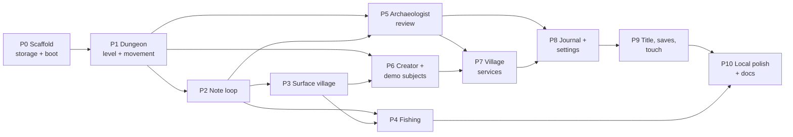

# Side-Scroller Host Example — Implementation Plan

| Field | Value |
|---|---|
| Plan version | 2.1 |
| Status | In progress — P0–P5 done; P6 next (P6–P10 planned) |
| Created | 2026-11-23 |
| Owner | Unassigned |
| Phase documents | [P0](phase-0-scaffold.md) · [P1](phase-1-dungeon-level.md) · [P2](phase-2-note-loop.md) · [P3](phase-3-surface-village.md) · [P4](phase-4-fishing.md) · [P5](phase-5-review.md) · [P6](phase-6-creator.md) · [P7](phase-7-village.md) · [P8](phase-8-journal.md) · [P9](phase-9-shell-mobile.md) · [P10](phase-10-polish.md) |
| Evidence index | [EVIDENCE.md](EVIDENCE.md) |
| Visual record | [VISUALS.md](VISUALS.md) |
| Boundary rules | [ENGINE-BOUNDARY.md](ENGINE-BOUNDARY.md) |
| Base commit | `3951737` (`Add project documentation and host UI guide`) |

This plan turns Knowledge Dungeon Engine into a small, playable side-scroller host
under `examples/side-scroller/`. It is additive: the engine's `src/`, published
exports, and storage contract do not change. Every phase has its own document with
task IDs, checklists, an exit gate, sub-agent opportunities, and an evidence log.

---

## 1. Purpose

The engine is headless and renderer-neutral
([README](../../../README.md#architecture),
[ADR-0001](../../adr/0001-headless-renderer-neutral-engine.md)). It deliberately
ships no screen, camera, assets, or save backend
([host guide](../../host-ui-guide.md#what-the-engine-gives-you)). The repository's
own gap list names additional host packages or examples as unshipped
([README](../../../README.md#whats-next)). This plan ships the first one — the root
README's [Reference Host](../../../README.md#reference-host) section points at it — and
keeps it additive so it can be deleted without touching the engine.

This plan builds one such example to answer a product question: **does the engine's
learning loop feel good when presented as a side-view dungeon?**

The chosen world shape, confirmed with the maintainer:

```text
Surface  ── side-view village street (VILLAGE_MAP.structures as facades)
              │
              │ host-authored entrance shaft
              ▼
Underground ── generated dungeon map in side view
              chambers + horizontal tunnels + vertical ladder shafts
```

Both README and the host guide state that a side-scrolling host must supply its own
movement and collision while reusing learning and progression rules
([README](../../../README.md#about), [host guide](../../host-ui-guide.md#screen-and-flow-design)).

P0–P4 delivered a playable Scribe + fishing slice. P5–P10 complete the example as a game:
the missing Creator and Archaeologist phases, a village where every labelled building
serves a purpose, a journal/settings shell, save portability, touch controls, and a local
ship pass. They remain strictly additive to the engine; every boundary decision is in
[ENGINE-BOUNDARY.md](ENGINE-BOUNDARY.md).

## 2. Confirmed decisions

These were answered by the maintainer and are not open for reinterpretation
without updating this table.

| ID | Question | Decision |
|---|---|---|
| D-01 | Plan document location | `docs/plans/side-scroller-host/` |
| D-02 | Execution evidence | Per-phase evidence section plus `EVIDENCE.md` index |
| D-03 | Plan scope | Phases P0–P4, including fishing |
| D-04 | Example test wiring | Isolated example suite; root `npm test` stays engine-only |
| D-05 | Movement approach | Side-scroller over the engine-generated dungeon map, not `dungeonNavigation.move` |
| D-06 | UI stack | Vanilla TypeScript + Vite + Canvas 2D |
| D-07 | Example location | `examples/` in this repository |
| D-08 | Surface perspective | Side-view street |
| D-09 | Visual record | Dated screenshots under `docs/plans/side-scroller-host/visuals/pN/`, indexed by [VISUALS.md](VISUALS.md) and captured with `examples/side-scroller/scripts/capture-dungeon.mjs` |
| D-10 | Post-P4 scope | Full six phases, P5–P10, covering the complete local game UI and functionality |
| D-11 | Presentation | Keep placeholder rectangles; no sprites, tilesets, audio, music, or voice in this plan |
| D-12 | Mobile | Touch controls and responsive layouts are in scope (P9); S-01 expands to current mobile Safari/Chrome |
| D-13 | Release | Local only; no CI workflow, deployment, PWA, or hosting in this plan |
| D-14 | Engine boundary | Strictly example-only. No `src/`, export-map, or storage-schema changes. [ENGINE-BOUNDARY.md](ENGINE-BOUNDARY.md) records the rule and the escalation path for future host UIs |
| D-15 | Demo content | Seed three synthetic demo subjects in P6 (`demo-rivers`, `demo-sky`, `demo-kitchen`) |
| D-16 | Review entry | `R` from a cleared room plus a Library desk in P7; the review panel itself ships in P5 |
| D-17 | Creator scope | A room-tree editor with forms, not a canvas node graph or tile editor |
| D-18 | Deferred engine capabilities | Fish trading, NPC dialogue state, multi-save slots, and cloud sync stay out of scope; see [ENGINE-BOUNDARY.md §6](ENGINE-BOUNDARY.md#6-deferred-capabilities) |

## 3. Goals and non-goals

### Goals

- Prove the engine can back a real side-view game loop without engine changes.
- Exercise the commands most likely to shape a host UI: `recordRoomVisit`,
  `submitNote`, `collectArtifact`, `interactVillageStructure`, `returnToVillage`,
  the fishing commands, and (P5–P9) review, graph, equipment, statistics, assistance,
  and save-portability commands.
- Close the engine's full learning loop in the host: **Creator → Scribe → Archaeologist**,
  with fishing and a village that gives every labelled building a purpose.
- Keep every phase small enough to gate and evidence independently.
- Leave a reusable reference host that is not coupled to a framework, is keyboard- and
  touch-operable, and can be deleted without touching the engine.

### Non-goals

- Art production, audio, music, or voice. Placeholder rectangles and silence are
  deliberate (D-11).
- A canvas node-graph editor or a tile-level level editor. P6 is a room-tree editor;
  dungeon geometry stays generated.
- Replacing the engine's grid navigation or floor-visibility rules.
- Multi-device sync, accounts, cloud storage, anti-cheat, or online services.
- Fish trading, NPC state mutation, or multiple save slots; see
  [ENGINE-BOUNDARY.md §6](ENGINE-BOUNDARY.md#6-deferred-capabilities).
- CI workflows, hosted deployment, PWA install, or app-store packaging (D-13).

## 4. Requirements and traceability

Each requirement is traced to the phases that implement it and the check that proves
it. Task IDs live in the phase documents.

| ID | Requirement | Source | Phases | Proof |
|---|---|---|---|---|
| R-01 | Boot one engine instance with a durable browser storage adapter | [host guide §Boot](../../host-ui-guide.md#boot-and-state-flow) | P0 | G0, A-06 |
| R-02 | Derive a side-view dungeon level from `generateDungeonMap` | D-05; [ADR-0009](../../adr/0009-grid-layout-and-floor-walkability.md) | P1 | G1, E-04 |
| R-03 | Host-owned gravity, jump, ladder, and AABB collision | [host guide §Platform](../../host-ui-guide.md#platform-considerations) | P1 | G1, E-04 |
| R-04 | Record exactly one study visit per room entry | [host guide §Study Sessions](../../host-ui-guide.md#study-sessions) | P1 | G1, E-04 |
| R-05 | Note composer drives `submitNote` and renders both outcomes | [commands.ts](../../../src/application/contracts/commands.ts) | P2 | G2, E-05 |
| R-06 | Progression HUD and cleared-room presentation | [README features](../../../README.md#features) | P2 | G2, A-04 |
| R-07 | Refusals and save failures are distinct, visible states | [ADR-0004](../../adr/0004-result-vs-rejection-contract.md) | P2, P3, P4 | G2–G4, E-06 |
| R-08 | Keyboard-only operation and screen-reader announcements | [host guide §Accessibility](../../host-ui-guide.md#accessibility-and-mobile) | P1–P4 | G4, E-07 |
| R-09 | Side-view surface street from `VILLAGE_MAP` data | D-08 | P3 | G3, E-08 |
| R-10 | Portal entry and return-to-village flows | [creatorEngine.ts](../../../src/creatorEngine.ts) | P3 | G3, A-08 |
| R-11 | Fishing cast/bite/reel plus keep/release with recall | [ADR-0008](../../adr/0008-fishing-state-machine-and-command-layer.md) | P4 | G4, E-09 |
| R-12 | Example tests isolated from the engine suite | D-04 | P0–P4 | G0, E-02 |
| R-13 | Engine source and runtime dependencies unchanged | [README contribute](../../../README.md#how-to-contribute) | All | G0–G10, E-10 |
| R-14 | Execution evidence recorded per phase | D-02 | All | G0–G10, E-11 |
| R-15 | Rollout and rollback documented and reversible | This plan | P0, P4, P10 | G4, G10, E-12 |
| R-16 | Cleared rooms can be reviewed with a 0–5 rating, due dates, and resumable interrupted reviews | [ADR-0007](../../adr/0007-sm2-review-scheduling-and-interrupted-sessions.md) | P5 | G5, E-13 |
| R-17 | Creator can create subjects and room graphs; three demo subjects seed idempotently; every subject is a village portal | `createSubject`, `dispatchGraph` | P6 | G6, E-14 |
| R-18 | Every labelled building opens a real service; read-only surfaces are labelled as such | `villageStructures`, progression, statistics, NPC contract | P7 | G7, E-15 |
| R-19 | Journal, character, statistics, assistance, and host settings are available and accessible | `statistics`, `assistance`, progression | P8 | G8, E-16 |
| R-20 | Title/new/continue, archetype choice, save export/import, and touch controls work | storage + host shell | P9 | G9, E-17 |
| R-21 | Local polish, performance, accessibility, docs, and a repeatable local gate are complete | This plan | P10 | G10, E-18 |
| R-22 | P5–P10 remain strictly example-only; the boundary and future-UI escalation path are documented | [ENGINE-BOUNDARY.md](ENGINE-BOUNDARY.md) | All | G5–G10, E-10 |

## 5. Phase map

| Phase | Document | Depends on | Blocks | Exit gate | Est. size |
|---|---|---|---|---|---|
| P0 | [Scaffold, storage, boot](phase-0-scaffold.md) | — | P1 | G0 | Small |
| P1 | [Dungeon level and movement](phase-1-dungeon-level.md) | P0 | P2 | G1 | Large |
| P2 | [Note loop](phase-2-note-loop.md) | P1 | P3, P4 | G2 | Medium |
| P3 | [Surface village](phase-3-surface-village.md) | P2 | P4 | G3 | Medium |
| P4 | [Fishing](phase-4-fishing.md) | P2, P3 | P10 | G4 | Medium |
| P5 | [Archaeologist review](phase-5-review.md) | P1, P2 | P7, P8 | G5 | Large |
| P6 | [Creator and demo campaign](phase-6-creator.md) | P1, P3 | P7, P8 | G6 | Large |
| P7 | [Village services](phase-7-village.md) | P5, P6 | P8 | G7 | Large |
| P8 | [Journal and settings](phase-8-journal.md) | P5–P7 | P9 | G8 | Medium |
| P9 | [Shell and touch](phase-9-shell-mobile.md) | P8 | P10 | G9 | Medium |
| P10 | [Local polish and docs](phase-10-polish.md) | P5–P9 | — | G10 | Medium |


P4 depends on P2 because fishing refuses until a room is cleared
(`isFishingEligible` check in `dispatchFishing`,
[creatorEngine.ts](../../../src/creatorEngine.ts)), and on P3 because the pond entry
point lives on the surface.

## 6. Cross-phase engineering rules

1. **Engine boundary.** No changes under `src/`, `tests/`, `package.json` exports, or
   runtime dependencies. The only root configuration change permitted is a test
   exclusion for `examples/**` in `vitest.config.ts` (P0-T4), recorded as such.
2. **One writer per file.** Sub-agents may not edit a file another agent owns in the
   same phase. The main agent owns integration files (`main.ts`, `index.html`).
3. **Interface first.** Each phase freezes its module interfaces before parallel work
   starts; interfaces are recorded in the phase document.
4. **Local state stays local.** Movement, camera, physics, and in-progress casts never
   commit engine state. Only commands do.
5. **No per-frame snapshots.** `snapshot()` at boot and for one-shot reads; subscribed
   state everywhere else ([host guide §Performance](../../host-ui-guide.md#performance)).
6. **Isolated tooling.** The example has its own `package.json`, lockfile, `tsconfig`,
   and Vitest config. Root commands must not discover example tests.
7. **Evidence is append-only.** Never rewrite an earlier gate result; supersede it with
   a new dated entry and explain why.
8. **One phase per merge.** A phase merges only with its gate green and its evidence
   entry written ([EVIDENCE.md](EVIDENCE.md)).
9. **The boundary document governs.** [ENGINE-BOUNDARY.md](ENGINE-BOUNDARY.md) is the
   escalation path for any missing engine capability. A host workaround that writes
   state or reimplements a rule is a failed phase, even if the screen looks right.

## 7. Example architecture

```text
examples/side-scroller/
  package.json            private, type module; dev/build/typecheck/test/preview
  vite.config.ts          '@' alias to ../../src
  tsconfig.json           own baseUrl/paths; includes src + tests
  vitest.config.ts        node environment; own alias
  index.html              canvas + DOM overlay roots
  scripts/
    capture-dungeon.mjs   WebDriver visual-record capture (host tooling)
    gate.mjs              local gate: root + example suites, probe, src diff (P10)
  src/
    main.ts               boot, screen routing, frame loop
    storage.ts            IndexedDB EngineStorage adapter
    engine.ts             engine singleton + one subscription + command wrapper
    settings.ts           host-local settings (P8)
    saveBundle.ts         export/import codec, base64 attachments (P9)
    touchControls.ts      pointer intents feeding the keyboard intent state (P9)
    level/
      model.ts            LevelModel types and derivation contract
      dungeonLevel.ts     DungeonMap -> LevelModel
      surfaceLevel.ts     VillageMapDef -> LevelModel (P3)
    physics.ts            fixed-step AABB movement, gravity, ladders
    render/
      canvas.ts           draw world, rooms, player, camera
      hud.ts              XP, subject, room status, journal summary
    ui/
      notePanel.ts        DOM composer, outcomes, focus management
      prompts.ts          proximity prompt, announcements
      recallDialog.ts     caught fish + recall dialog (P4)
      reviewPanel.ts      review rating and interrupted sessions (P5)
      creatorPanel.ts     subject list + room-tree editor (P6)
      servicePanel.ts     interior shell and routing (P7)
      libraryPanel.ts     review desk + archive (P7)
      trophyPanel.ts      badges, fish, records (P7)
      workshopPanel.ts    inventory and equipment (P7)
      fishStandPanel.ts   read-only collection (P7)
      journalPanel.ts     overview, subjects, records, assistance (P8)
      titlePanel.ts       continue/new/import/archetype (P9)
      touchOverlay.ts     visible touch controls (P9)
    fishing/              P4 modules (bridge, session, scene)
    review/               review projection (P5)
    creator/              creator projection + demo seeds (P6)
    village/               service projections, NPC dialogue (P7)
    journal/              journal + assistance projections (P8)
    projection.ts         EngineState -> view models, pure
  tests/                  one suite per phase plus shared fixtures
```

The engine is imported through `src/index.ts`, whose namespaces are the public
surface ([index.ts](../../../src/index.ts)). Vite resolves the `@` alias to engine
source; the example typechecks against the same files the engine builds.

## 8. Acceptance criteria

### Product

- **A-01** Fresh boot reaches the tutorial dungeon without console errors.
- **A-02** The player can walk, jump, and climb to every room in the tutorial subject.
- **A-03** Entering a room records one study visit; leaving and re-entering records a
  second.
- **A-04** A valid note clears the room, awards XP, and updates the HUD without reload.
- **A-05** An invalid note shows the specific requirement that failed, and the room
  remains uncleared.
- **A-06** Reload restores the same world, cleared rooms, XP, and fish collection.
- **A-07** The surface street shows village structures and subject portals from engine
  data, not a hard-coded list.
- **A-08** A portal enters the subject's dungeon; return-to-village closes the study
  session.
- **A-09** After a clear, fishing can be entered; keep with a correct recall adds the
  fish, release does not.
- **A-10** The whole critical path is playable keyboard-only.
- **A-11** A cleared room can be reviewed; the rating updates SM-2 and pays at most one
  reward per (room, pass); an interrupted review can be saved and resumed.
- **A-12** A player can create a subject and room graph; three seeded demo subjects appear
  as portals; a created subject can be entered, cleared, and reloaded.
- **A-13** Every labelled building opens a real service; Fish Stand and NPCs are visibly
  read-only.
- **A-14** The journal shows progress, records, inventory, fish, due rooms, and assistance
  from engine data; settings persist and apply immediately.
- **A-15** New/continue and archetype selection work; a save bundle exports and imports
  rooms, XP, fish, schedule, and attachment bytes; a bad import cannot corrupt the save.
- **A-16** The critical path is playable touch-only on a phone-sized viewport.
- **A-17** The full first-ten-minutes path completes with no console errors.

### Engineering

- **E-01** Root `npm test`, `npm run typecheck`, and `npm run build` stay green at every
  gate; the recorded engine test count does not change.
- **E-02** Root test discovery does not include `examples/**`.
- **E-03** Example `npm run typecheck`, `npm test`, and `npm run build` pass.
- **E-04** Headless tests cover level derivation, physics landing/tunneling, and visit
  de-duplication.
- **E-05** Projection tests cover draft, cleared, and refusal states without a renderer.
- **E-06** A rejecting storage adapter produces a visible "not saved" state and leaves
  the prior state intact.
- **E-07** Keyboard focus order, live-region announcements, and reduced-motion handling
  are manually checked and recorded.
- **E-08** Surface routing is tested from an `EngineState` fixture.
- **E-09** Fishing replay with a fixed seed and event sequence produces the same phase,
  catch, and reward outcome.
- **E-10** Root `src/` has no diff attributable to the example.
- **E-11** Every gate result is present in [EVIDENCE.md](EVIDENCE.md) with date, commit,
  commands, and outcome.
- **E-12** Rollback requires only deleting `examples/side-scroller` and reverting the
  documented root config entries.
- **E-13** Review tests cover appointment labels, one SM-2 update per pass, idempotent
  rewards, save/resume/discard across a reload, and a rejected write.
- **E-14** Creator tests cover graph mutations and typed refusals, idempotent demo seeding,
  no resurrection after deletion, and portal projection from engine data.
- **E-15** Service projections cover populated and empty states; equipment round-trips
  through `MemoryEngineStorage`; NPC line selection is deterministic.
- **E-16** Journal/statistics/assistance projections are tested from fixtures; settings
  load/save/reset and malformed-value fallbacks are tested.
- **E-17** Save-bundle round trip preserves `Uint8Array` attachments; invalid bundles are
  rejected without touching the current save; touch intents match keyboard intents.
- **E-18** The local gate script reproduces the full check set, the boundary document is
  current, and the example README matches the running build.

## 9. Validation plan

### Automated, every gate

| Suite | Command | Must show |
|---|---|---|
| Engine tests | `npm test` | Green; count equal to the P0 baseline |
| Engine typecheck | `npm run typecheck` | Clean |
| Engine build | `npm run build` | Clean |
| Example typecheck | `npm --prefix examples/side-scroller run typecheck` | Clean |
| Example tests | `npm --prefix examples/side-scroller test` | Green; includes phase-specific tests |
| Example build | `npm --prefix examples/side-scroller run build` | Clean |
| Isolation probe | `npx vitest list --config vitest.config.ts` | No `examples/` paths |
| Local gate (P10) | `node examples/side-scroller/scripts/gate.mjs` | All of the above, plus an empty `src` diff |

Exact commands and output summaries go in the phase evidence tables. Do not record
learner prose or secrets.

There is no CI workflow in this plan (D-13). The local gate is the repeatable substitute.

### Manual smoke script (P2–P10)

1. Clear site data for the example origin; load the page.
2. Confirm the title/continue flow and, on a new game, the archetype choice.
3. Confirm the tutorial dungeon appears and the HUD shows 0 XP.
4. Walk into each of the three tutorial rooms; confirm exactly one visit each in the
   study-session view.
5. Submit an incomplete note; confirm the specific missing section is shown.
6. Submit a complete note with confirmation; confirm clear, XP, and artifact.
7. Reload; confirm the cleared room and XP survive.
8. Walk to the surface; confirm structures and portals are drawn from engine data,
   including the three demo subjects.
9. Enter the tutorial portal, clear a room if needed, return to the village.
10. Press `R`, review a due room, rate it, and confirm the schedule moved.
11. Enter Creator, create a subject with three rooms, tag one, cross-link two, enter it,
    clear a room, and reload.
12. Open the Library, Guild Hall, Trophy Hall, Workshop, Fish Stand, and an NPC; confirm
    each does something real and read-only surfaces say so.
13. Enter fishing; cast, hook, answer recall, keep; confirm the fish appears after
    reload. Repeat with release; confirm no collection change.
14. Open the journal; inspect progress, records, inventory, fish, due rooms, assistance;
    change text size and assistance mode.
15. Export the save, clear site data, import it, and confirm rooms, XP, fish, schedule,
    and an attachment survive. Try a malformed file and confirm the old save is intact.
16. On a phone-sized viewport, play the path touch-only: title, move, jump, enter, note,
    review, fish, journal.
17. Tab through the entire desktop path without a mouse; confirm focus is visible and
    outcomes are announced.

For a visual record of the run, use the capture script (Firefox and `geckodriver`
required):

```sh
node examples/side-scroller/scripts/capture-dungeon.mjs \
  --out docs/plans/side-scroller-host/visuals/p2 \
  --prefix 2026-11-23-g2 --low-fps --reduced-motion
```

Append the printed rows and images to [VISUALS.md](VISUALS.md). P5–P9 add their own
capture modes (`--review`, `--creator`, `--services`, `--journal`, `--mobile`) so each
gate has a dated record.

### Performance and accessibility checks

- Frame loop: no `snapshot()` call inside the frame callback; asserted by code review
  and a grep evidence entry.
- Frame time: record a 10-second performance capture at every new gate; no frame over
  16.7 ms on the development machine, or document the exception (P2-O1).
- Reduced motion: enable the OS preference; camera, transitions, and any host animation
  are disabled. Motion is never forced.
- Contrast: room status, rarity, due state, and validity are not colour-only.
- Mobile: 390×844 (portrait) and 844×390 (landscape) viewports; no overlap, no page
  scroll while playing, touch targets ≥ 44 px.
- Large text: HUD, dialogs, and canvas labels do not clip at the `large` setting.

## 10. Risks

| ID | Risk | Likelihood | Impact | Mitigation | Trigger |
|---|---|---|---|---|---|
| K-01 | Generated tutorial map is awkward in side view (tall shafts, rooms above root) | High | Medium | Ladders on every vertical corridor segment; continuous camera; presentation scale adjustable; `LevelModel` adapter keeps a hand-authored fallback possible without touching gameplay | P1 gate cannot traverse all three rooms |
| K-02 | 1-tile corridors feel cramped at any scale | Medium | Medium | Render scale 3× (72 px corridors); player hitbox narrower than corridor; visual walls thinner than collision | Playtest note at G1 |
| K-03 | Tile collision lets the player tunnel at low frame rates | Medium | High | Fixed 1/120 s substeps, max 5 per frame, 100 ms delta clamp, continuous axis-separated resolution | Physics test fails or manual low-FPS check fails |
| K-04 | Root Vitest unexpectedly picks up example tests | Medium | Medium | Explicit `exclude: ['examples/**']` plus isolation probe in every gate | E-02 probe lists an example path |
| K-05 | IndexedDB unavailable or quota exceeded | Low | High | Fail loudly with a visible storage error; document supported browsers; no silent in-memory fallback | G0 boot test |
| K-06 | `EngineState` attachment bytes are lost by a naive serializer | Medium | High | IndexedDB structured clone stores `Uint8Array` natively; test a fixture containing attachment bytes | Storage round-trip test |
| K-07 | `recordRoomVisit` throws because no study session is active | Medium | Medium | Enter through `startTutorial` / portal commands only; boot recovery follows host guide §Study Sessions; explicit error surfaced | Any `Room not found` / `No active study session` rejection |
| K-08 | Note validation feels like a guess | Medium | Medium | Prefilled section template; render exact failed checks; keep the confirmation checkbox user-driven | G2 playtest |
| K-09 | Markdown/attachment injection in artifact display | Low | High | Render artifact as plain text in a `<pre>`; never `innerHTML`; no external fetches | Security review at G2 |
| K-10 | Top-down `VILLAGE_MAP` data does not map cleanly to a side view | Medium | Medium | Map only `gridX` to street position and treat `gridY` as depth ordering; document the mapping in P3; do not change engine data | P3 layout review |
| K-11 | Mid-dungeon reload leaves an open study session | Medium | Medium | P0 boot recovery test: `endStudySession(true)` then re-enter; evidence records the chosen path | G0 reload test |
| K-12 | Fishing mid-cast state cannot be resumed after reload | High | Low | Treat reload during fishing as session restart: return to village or re-enter pond; document in P4 | G4 reload check |
| K-13 | Example drifts from engine API during future refactors | Medium | Medium | Example typecheck runs against engine source at every gate; add to future CI if one exists | Typecheck failure |
| K-14 | Example needs result types that `src/index.ts` does not re-export | Medium | Low | Type-only imports from the aliased source; record each as a candidate engine export; never edit `src/index.ts` in this plan | Typecheck cannot name an outcome without an internal import |
| K-15 | Review needs an active subject, and activating one starts a study session | Medium | Medium | Enter from a cleared room when possible; from the street, activate then always `returnToVillage()`; test no session is left open | Any open session after closing the Library |
| K-16 | Creator mutations run only on the active subject; wrong-subject edits | Medium | High | Activate explicitly before editing; show the active subject in the editor; re-read state after every mutation | Tree shows another subject's rooms |
| K-17 | Demo seeds resurrect after deletion or duplicate on re-run | Medium | Medium | First-run host flag plus id checks; never seed when the flag is set; idempotency test | A deleted demo subject returns |
| K-18 | Service scope creep turns into a shop/economy | Medium | Medium | Fixed service matrix; Fish Stand is display-only; new writes need an engine plan | A "sell" or "buy" control appears |
| K-19 | Read-only surfaces look broken | Medium | Medium | Label them explicitly and omit transactional controls; empty states name the source | Player expects a purchase/trade |
| K-20 | Save export/import corrupts attachments or trusts hostile JSON | Medium | High | Base64 round-trip test with a byte fixture; validate version/app/shape; write only after full decode | Imported save loses an attachment |
| K-21 | Touch and keyboard drift into two movement implementations | Medium | High | Both write one intent state; mapping test compares them; pointer cancel clears held intents | Touch can move while keyboard cannot |
| K-22 | Mobile IndexedDB/quota fails differently from desktop | Medium | High | Keep the loud storage failure; test mobile private/limited modes; no in-memory fallback | Boot/import fails on a phone |
| K-23 | "Polish" becomes art/audio production | Medium | Medium | Placeholder rectangles and silence are decisions; P10 fixes only playtest issues | A sprite or sound file appears |
| K-24 | Boundary drift: a host phase quietly edits `src/` | Low | High | `git status --short src` and `git diff --stat src` at every gate; boundary doc escalation path; gate script | Any `src/` diff |

## 11. Rollout, migration, and rollback

### Rollout

- The example is additive and unreferenced by the engine's export map
  ([package.json](../../../package.json)). `files: ["dist", "LICENSE"]` is unchanged,
  so npm contents are unaffected.
- No engine state schema, command, or persistence change is introduced.
- Both root and example dependencies are installed separately; there is no workspace,
  so root `package-lock.json` is not rewritten.
- Landing order is P0 → P1 → P2 → P3 → P4 → P5 → P6 → P7 → P8 → P9 → P10, one phase per
  merge.
- P5–P10 stay local. No CI workflow, deployment, hosting, or PWA is added (D-13); the
  P10 gate script is the repeatable check.
- Mobile support is a tested local target from P9 onward; S-01 names the browsers.

### Migration

- None required. Existing engine saves are untouched.
- The example's IndexedDB database is host-owned and disposable; it is not a supported
  migration source for Knowledge Dungeon saves
  ([README](../../../README.md#storage-contract)).

### Rollback

- Delete `examples/side-scroller/` (including `scripts/capture-dungeon.mjs` and
  `scripts/gate.mjs`) and the phase documents under `docs/plans/side-scroller-host/`.
- Revert the documented root entries: the `examples/**` exclusion in
  `vitest.config.ts` and any `.gitignore` additions.
- The visual record (`VISUALS.md`, `visuals/`) and [ENGINE-BOUNDARY.md](ENGINE-BOUNDARY.md)
  are documentation only; remove them with the plan if the whole example is abandoned.
- Exported save bundles are ordinary JSON; they remain readable by the engine alone.
- No data migration, feature flag, or engine version bump is needed.

## 12. Evidence policy

- Each phase document ends with an **Execution evidence** table. Rows are duplicated
  into the index in [EVIDENCE.md](EVIDENCE.md) with a link back to the anchor.
- Required fields: date (UTC), phase/task or gate, commit SHA (or `uncommitted`),
  command or artifact, result (`pass` / `fail` / `blocked`), and a one-line note.
- Gate entries additionally record: acceptance criteria verified, the exact test counts,
  and any accepted exception with its risk ID.
- Failed gates stay in the log. A later pass is a new row that references the failure.
- Screenshots are kept in-repo under the plan folder's `visuals/pN/` and indexed in
  [VISUALS.md](VISUALS.md), with one manifest per gate. They may show the tutorial fixture
  and placeholder art only; never learner content. Performance traces may stay as host
  artifacts with a path and a summary.
- The capture script (`examples/side-scroller/scripts/capture-dungeon.mjs`) drives the real
  app over WebDriver and adds no test hooks to the page.

## 13. Sub-agent policy

Available sub-agent types are `explore` (read-only) and `general` (can execute). The
phase documents name concrete opportunities with file ownership.

Rules:

- Start each phase with one `explore` task to confirm the exact engine symbols and
  line references the phase depends on; fold corrections into the phase document before
  coding.
- Parallel `general` tasks only after the phase interfaces are frozen.
- Never let two agents write the same file. `main.ts`, `index.html`, and
  `vite.config.ts` stay with the main agent.
- Each sub-agent returns: files changed, tests added, commands run, and any deviation
  from this plan. The main agent runs the phase gate, not the sub-agent.
- Sub-agents do not modify `src/`, root configs, or other phases' files.

## 14. Phase status board

| Phase | Status | Gate | Evidence |
|---|---|---|---|
| P0 | Done — G0 passed | G0 passed 2026-11-23 | [phase-0 evidence](phase-0-scaffold.md#execution-evidence) |
| P1 | Done — G1 passed | G1 passed 2026-11-23 | [phase-1 evidence](phase-1-dungeon-level.md#execution-evidence) |
| P2 | Done — G2 passed | G2 passed 2026-11-23 | [phase-2 evidence](phase-2-note-loop.md#execution-evidence) |
| P3 | Done — G3 passed | G3 passed 2026-11-23 | [phase-3 evidence](phase-3-surface-village.md#execution-evidence) |
| P4 | Done — G4 passed | G4 passed 2026-11-24 | [phase-4 evidence](phase-4-fishing.md#execution-evidence) |
| P5 | Done — G5 passed | G5 passed 2026-11-24 | [phase-5 evidence](phase-5-review.md#execution-evidence) |
| P6 | Not started | G6 pending | — |
| P7 | Not started | G7 pending | — |
| P8 | Not started | G8 pending | — |
| P9 | Not started | G9 pending | — |
| P10 | Not started | G10 pending | — |

Visual record: [VISUALS.md](VISUALS.md) — P1/G1, P2/G2, P3/G3 frames captured 2026-11-23; P3 layout follow-up 2026-11-24; P3 polish frames 2026-11-24; P4/G4 pond loop frames 2026-11-24 and the interaction-feedback follow-up (`g4b`); P5/G5 review frames 2026-11-24 in a normal and a reduced-motion run (`g5`, `g5rm`). P6–P10 append their own `visuals/pN/` folders as they ship.

## 15. Assumptions

These are presentation and scope choices, not engine facts. Update this section before a
phase relies on a changed answer.

| ID | Assumption | Default |
|---|---|---|
| S-01 | Supported browsers | Desktop evergreen Chrome and Firefox; from P9 also current mobile Safari and Chrome. IndexedDB and Canvas 2D required; no in-memory fallback |
| S-02 | Visual style | Placeholder rectangles and text; no image assets in the repository |
| S-03 | Render scale | 3× engine tiles (72 px); player hitbox narrower than one corridor |
| S-04 | Audio | None in the example; fishing audio hooks are ignored |
| S-05 | Root package changes | Only the Vitest `examples/**` exclusion is allowed; no root scripts for P10 |
| S-06 | Engine boundary | Strictly example-only; [ENGINE-BOUNDARY.md](ENGINE-BOUNDARY.md) governs every phase |
| S-07 | Demo content | Three seeded synthetic subjects in P6; no learner data in seeds or evidence |

## 16. Change log

| Date | Version | Change |
|---|---|---|
| 2026-11-23 | 1.0 | Initial plan after maintainer decisions D-01…D-08 |
| 2026-11-23 | 1.1 | P0 executed and G0 passed; added `@types/node` and `fake-indexeddb` as example-only dev dependencies; recorded evidence |
| 2026-11-23 | 1.2 | P1 executed and G1 passed; side-view level, physics, renderer, camera, HUD, and visit de-duplication; amendments recorded in the P1 document |
| 2026-11-23 | 1.3 | Added the in-repo visual record ([VISUALS.md](VISUALS.md)) and the repeatable WebDriver capture script; P1/G1 frames stored under `visuals/p1/` (D-09) |
| 2026-11-23 | 1.4 | P2 executed and G2 passed; note composer, draft/clear/refusal/save-failure states, `projectHud`, save-failure harness, keyboard trap, and the `--note-loop` capture mode; frames under `visuals/p2/` |
| 2026-11-23 | 1.5 | P3 executed and G3 passed; side-view surface from `VILLAGE_MAP`, dungeon placement below the street, climbable entrance shaft, portal/return routing, surface HUD, `--surface` capture mode; frames under `visuals/p3/` |
| 2026-11-24 | 1.6 | P3 playtest fix and G3 re-run; facades are background-only, buildings are spaced 1.6× with a 3-tile minimum gap, spawn/entrance/return follow the Training Grounds door; new frames under `visuals/p3/` (`2026-11-24-g3`) |
| 2026-11-24 | 1.7 | P3 polish pass; skyline/moon, facade lights and shadows, paving, shaft chevron, readable portal signs, deduped surface HUD with pond locations, and a “No door in reach” announcement; frames under `visuals/p3/` (`2026-11-24-g3p`) |
| 2026-11-24 | 1.8 | P4 executed and G4 passed; pond entry from host-resolved active subject, cast/bite/reel scene, engine-backed recall dialog, keep/release, save-failure and mid-cast reload recovery, `--fishing` capture mode; frames under `visuals/p4/` (`2026-11-24-g4`); all phases complete |
| 2026-11-24 | 1.9 | Interaction-feedback follow-up after playtest: pond refusals and non-portal facade messages appear as a canvas toast, plus copy tests and a `g4b` re-capture |
| 2026-11-24 | 2.0 | Post-P4 roadmap planned: P5 review, P6 Creator + three demo subjects, P7 village services, P8 journal/settings/assistance, P9 title/save/touch, P10 local polish/docs. Placeholder art and silence remain; local-only release; strict example-only boundary plus [ENGINE-BOUNDARY.md](ENGINE-BOUNDARY.md) |
| 2026-11-24 | 2.1 | P5 executed and G5 passed; 0–5 review panel, due queue and HUD count, `R` from a room and the street, save/resume/discard across reload, duplicate ledger proof, rejected-write path, `--review` capture mode with a reduced-motion re-run; frames under `visuals/p5/`; engine count unchanged and no `src/` diff |
