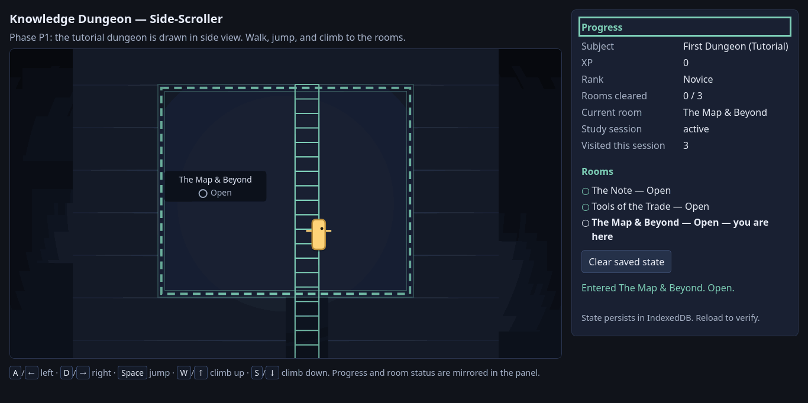
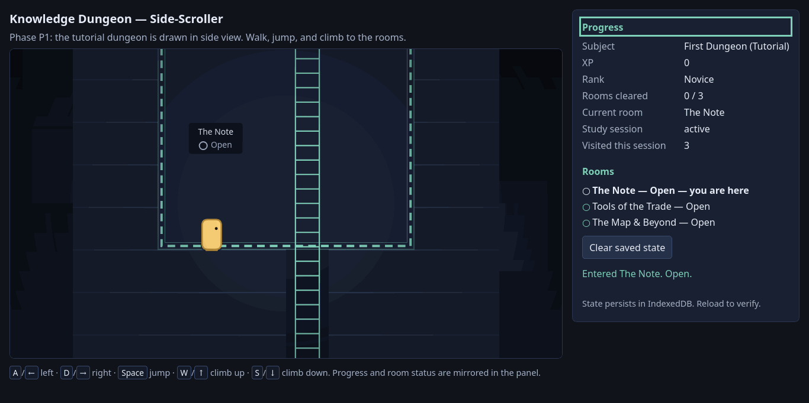

# Visual Record — Side-Scroller Host

Running, append-only visual history for [the implementation plan](README.md). The gate
evidence records *what passed*; this file records *what the host looked like* when it
passed.

## Rules

- **Append-only.** Never replace a gate's images. If a frame is wrong, capture a new dated
  frame and leave the old one in place with a note.
- **One folder per phase:** `visuals/p0/`, `visuals/p1/`, and so on.
- **File names:** `YYYY-MM-DD-gN-NN-slug.png`, where `NN` is the capture order. The
  capture script's `--prefix` produces exactly this pattern.
- **Content:** the full app window (canvas plus DOM HUD), tutorial fixture or synthetic
  data only. Never capture learner notes, topics, or subject names.
- **Every frame is dated and gated.** Record the commit (or `uncommitted`), the viewport,
  and the conditions that matter (low FPS, reduced motion, reload).
- **Keep the manifest.** Each gate gets a `<prefix>-manifest.json` beside its images,
  produced by the capture script and annotated with the gate facts.
- **Keep the repository light.** P1 frames were reduced to 256-colour PNGs (~30 KiB each).

## Index

| Date | Gate | Commit | Frame | File | What it shows |
|---|---|---|---|---|---|
| 2026-11-23 | G1 | uncommitted (base `989acf1`) | Root room | [`01-root-room.png`](visuals/p1/2026-11-23-g1-01-root-room.png) | Start; spawn in `tut-note`; XP 0; 0/3 cleared; visits 1 |
| 2026-11-23 | G1 | uncommitted | Lower room | [`02-tools-room-low-fps.png`](visuals/p1/2026-11-23-g1-02-tools-room-low-fps.png) | Ladder descent under a 55 ms/80 ms main-thread hog; visits 2; frames avg 37 ms, max 67 ms |
| 2026-11-23 | G1 | uncommitted | Upper room | [`03-map-room.png`](visuals/p1/2026-11-23-g1-03-map-room.png) | Climb ≈3.8 s; visits 3; label clear of the ladder |
| 2026-11-23 | G1 | uncommitted | Return to root | [`04-return-to-root.png`](visuals/p1/2026-11-23-g1-04-return-to-root.png) | Descend ≈1.1 s and step off; visits stays 3 (engine keeps a set) |
| 2026-11-23 | G1 | uncommitted | Reload | [`05-reload.png`](visuals/p1/2026-11-23-g1-05-reload.png) | Three rooms restored from IndexedDB; sessions 1 → 2; fresh session visits 1 |
| 2026-11-23 | G1 | uncommitted | Reduced motion | [`06-reduced-motion.png`](visuals/p1/2026-11-23-g1-06-reduced-motion.png) | `ui.prefersReducedMotion=1`; `matchMedia` true; camera snaps |

Manifest: [`2026-11-23-g1-manifest.json`](visuals/p1/2026-11-23-g1-manifest.json).

P0 predates this record: it proved boot and storage with a debug panel and captured no
frames. The record starts at P1.

## P1 — Dungeon level and movement

The tutorial generates as a vertical stack: `tut-note` at the root, `tut-tools` below,
`tut-map` above, joined by one ladder shaft at the room centre.

The teal outline on the Progress heading is the keyboard focus target after Start; the
start button is hidden once the dungeon opens.

### Start in the root room


### Lower room under low FPS


### Upper room after the climb



### Back in the root room



### After reload


### Reduced motion


## Capturing the next phase

Prerequisites: example dependencies installed, Firefox on `PATH`, and `geckodriver`
available. The app must be reachable at the script's `--base` (default
`http://localhost:5174/`); if Vite reports another port because 5174 is busy, pass it
explicitly.

```sh
# terminal 1 — the app
npm --prefix examples/side-scroller run dev

# terminal 2 — WebDriver
geckodriver --port 4444

# terminal 3 — capture from the repository root
node examples/side-scroller/scripts/capture-dungeon.mjs \
  --out docs/plans/side-scroller-host/visuals/p2 \
  --prefix 2026-11-23-g2 \
  --low-fps --reduced-motion
```

The script drives the real app over WebDriver:

1. reduced-motion session (when `--reduced-motion`);
2. start tutorial and the root frame;
3. optional main-thread hog and frame-interval measurement (`--low-fps`);
4. step off, ladder down, lower frame;
5. climb until the room actually changes, upper frame;
6. descend, step off, root frame;
7. reload and final frame;
8. writes `<prefix>-manifest.json` and prints Markdown rows for the index.

It does not add test hooks to the page or change engine state beyond normal commands.
Use a new `--prefix` for every gate so the record stays append-only.

After capturing, reduce the PNGs if the sizes are large. P1 used Pillow's 256-colour
FASTOCTREE, which preserves the player and status colours:

```sh
python3 - <<'PY'
from PIL import Image
import glob, os
for path in glob.glob('docs/plans/side-scroller-host/visuals/p2/*.png'):
    image = Image.open(path).convert('RGB').quantize(colors=256, method=Image.FASTOCTREE)
    image.save(path, optimize=True)
PY
```

Then append the printed rows to the index, add the images to the gallery, and reference
the visual record from that phase's execution evidence.
