# Visual Record — Side-Scroller Host

Running, append-only visual history for [the implementation plan](README.md). The gate
evidence records *what passed*; this file records *what the host looked like* when it
passed.

## Rules

- **Append-only.** Never replace a gate's images. If a frame is wrong, capture a new dated
  frame and leave the old one in place with a note.
- **One folder per phase:** `visuals/p0/`, `visuals/p1/`, and so on.
- **File names:** `YYYY-MM-DD-gN-NN-slug.png`, where `NN` is the capture order. The
  capture script's `--prefix` produces exactly this pattern.
- **Content:** the full app window (canvas plus DOM HUD), tutorial fixture or synthetic
  data only. Never capture learner notes, topics, or subject names.
- **Every frame is dated and gated.** Record the commit (or `uncommitted`), the viewport,
  and the conditions that matter (low FPS, reduced motion, reload).
- **Keep the manifest.** Each gate gets a `<prefix>-manifest.json` beside its images,
  produced by the capture script and annotated with the gate facts.
- **Keep the repository light.** P1 frames were reduced to 256-colour PNGs (~30 KiB each).

## Index

P5 was captured on 2026-11-24 (`visuals/p5/`, two runs: normal and reduced motion).
P6 was captured on 2026-11-24 (`visuals/p6/`, three runs: normal, reduced motion, and a
keyboard-only segment). P7–P10 are planned; their `visuals/p7/`–`visuals/p10/` folders
will be added as each gate is captured.

The P6 demo subject names — Rivers & Bridges, Sky & Weather, Kitchen Chemistry — are
synthetic authored content. No learner subject or note appears in the P6 record.

| Date | Gate | Commit | Frame | File | What it shows |
|---|---|---|---|---|---|
| 2026-11-23 | G1 | uncommitted (base `989acf1`) | Root room | [`01-root-room.png`](visuals/p1/2026-11-23-g1-01-root-room.png) | Start; spawn in `tut-note`; XP 0; 0/3 cleared; visits 1 |
| 2026-11-23 | G1 | uncommitted | Lower room | [`02-tools-room-low-fps.png`](visuals/p1/2026-11-23-g1-02-tools-room-low-fps.png) | Ladder descent under a 55 ms/80 ms main-thread hog; visits 2; frames avg 37 ms, max 67 ms |
| 2026-11-23 | G1 | uncommitted | Upper room | [`03-map-room.png`](visuals/p1/2026-11-23-g1-03-map-room.png) | Climb ≈3.8 s; visits 3; label clear of the ladder |
| 2026-11-23 | G1 | uncommitted | Return to root | [`04-return-to-root.png`](visuals/p1/2026-11-23-g1-04-return-to-root.png) | Descend ≈1.1 s and step off; visits stays 3 (engine keeps a set) |
| 2026-11-23 | G1 | uncommitted | Reload | [`05-reload.png`](visuals/p1/2026-11-23-g1-05-reload.png) | Three rooms restored from IndexedDB; sessions 1 → 2; fresh session visits 1 |
| 2026-11-23 | G1 | uncommitted | Reduced motion | [`06-reduced-motion.png`](visuals/p1/2026-11-23-g1-06-reduced-motion.png) | `ui.prefersReducedMotion=1`; `matchMedia` true; camera snaps |
| 2026-11-23 | G2 | uncommitted (base `f0eda0e`) | Reduced motion | [`06-reduced-motion.png`](visuals/p2/2026-11-23-g2-06-reduced-motion.png) | P2 build; `matchMedia` true; no panel transitions; focus on the Progress heading |
| 2026-11-23 | G2 | uncommitted | Dungeon re-run: root | [`01-root-room.png`](visuals/p2/2026-11-23-g2-01-root-room.png) | P2 build; visits 1; P1 traversal unchanged |
| 2026-11-23 | G2 | uncommitted | Dungeon re-run: lower room | [`02-tools-room-low-fps.png`](visuals/p2/2026-11-23-g2-02-tools-room-low-fps.png) | Deliberate 55 ms/80 ms hog; visits 2; frames avg 41 ms, max 67 ms |
| 2026-11-23 | G2 | uncommitted | Dungeon re-run: upper room | [`03-map-room.png`](visuals/p2/2026-11-23-g2-03-map-room.png) | Climb ≈3.6 s; visits 3 |
| 2026-11-23 | G2 | uncommitted | Dungeon re-run: return | [`04-return-to-root.png`](visuals/p2/2026-11-23-g2-04-return-to-root.png) | Descend ≈1.1 s; visits stays 3 |
| 2026-11-23 | G2 | uncommitted | Dungeon re-run: reload | [`05-reload.png`](visuals/p2/2026-11-23-g2-05-reload.png) | Three rooms restored; fresh session visits 1 |
| 2026-11-23 | G2 | uncommitted | Composer | [`07-composer.png`](visuals/p2/2026-11-23-g2-07-composer.png) | `E` opens; template prefilled; focus in `#note-text`; prompt hidden while open |
| 2026-11-23 | G2 | uncommitted | Draft | [`08-draft.png`](visuals/p2/2026-11-23-g2-08-draft.png) | Missing sections named (`Key Points, Recall Question`); XP 0; cleared 0 |
| 2026-11-23 | G2 | uncommitted | Cleared | [`09-cleared.png`](visuals/p2/2026-11-23-g2-09-cleared.png) | 28 XP; room `Cleared`; artifact plain text in `<pre>`; focus on Take artifact |
| 2026-11-23 | G2 | uncommitted | Composer closed | [`10-closed.png`](visuals/p2/2026-11-23-g2-10-closed.png) | `Escape` closes; focus returns to `#game`; artifact count 1 |
| 2026-11-23 | G2 | uncommitted | Reload after clear | [`11-reload.png`](visuals/p2/2026-11-23-g2-11-reload.png) | XP 28, cleared 1, artifact 1 survive IndexedDB |
| 2026-11-23 | G2 | uncommitted | Save failure | [`12-not-saved.png`](visuals/p2/2026-11-23-g2-12-not-saved.png) | Simulated quota failure; "Not saved" in panel and HUD; XP 28→28, cleared 1→1 |
| 2026-11-23 | G3 | uncommitted (base `fd8c171`) | Village street | [`01-street.png`](visuals/p3/2026-11-23-g3-01-street.png) | Fresh save; 0 subject portals; nearby Training Grounds; prompt visible; canvas focus outline |
| 2026-11-23 | G3 | uncommitted | Portal entry | [`02-dungeon-entry.png`](visuals/p3/2026-11-23-g3-02-dungeon-entry.png) | Training gate enters in 16 ms; world dungeon; 3 rooms; active session |
| 2026-11-23 | G3 | uncommitted | Room cleared | [`03-cleared.png`](visuals/p3/2026-11-23-g3-03-cleared.png) | 28 XP; room `Cleared`; artifact outcome; active session |
| 2026-11-23 | G3 | uncommitted | Returned through the shaft | [`04-returned.png`](visuals/p3/2026-11-23-g3-04-returned.png) | Climb ≈4.0 s; world village; active subject null; session closed; subject portal row shows 1/3 |
| 2026-11-23 | G3 | uncommitted | Reload on the street | [`05-reload-surface.png`](visuals/p3/2026-11-23-g3-05-reload-surface.png) | World village; one subject portal; cleared count survives |
| 2026-11-23 | G3 | uncommitted | Reload in the dungeon | [`06-reload-dungeon.png`](visuals/p3/2026-11-23-g3-06-reload-dungeon.png) | P0-T5 recovery; world dungeon; 3 rooms; active session |
| 2026-11-24 | G3 re-run | uncommitted (base `b44f24a`) | Village street (fixed layout) | [`01-street.png`](visuals/p3/2026-11-24-g3-01-street.png) | Facades are background-only; 3-tile building gap; spawn centred on the Training Grounds door; player can walk both ways |
| 2026-11-24 | G3 re-run | uncommitted | Portal entry | [`02-dungeon-entry.png`](visuals/p3/2026-11-24-g3-02-dungeon-entry.png) | Training gate enters in 21 ms; world dungeon; 3 rooms; active session |
| 2026-11-24 | G3 re-run | uncommitted | Room cleared | [`03-cleared.png`](visuals/p3/2026-11-24-g3-03-cleared.png) | 28 XP; room `Cleared`; active session |
| 2026-11-24 | G3 re-run | uncommitted | Returned through the shaft | [`04-returned.png`](visuals/p3/2026-11-24-g3-04-returned.png) | Climb ≈4.0 s; world village; session closed; portal row shows 1/3 |
| 2026-11-24 | G3 re-run | uncommitted | Reload on the street | [`05-reload-surface.png`](visuals/p3/2026-11-24-g3-05-reload-surface.png) | World village; one subject portal; cleared count survives |
| 2026-11-24 | G3 re-run | uncommitted | Reload in the dungeon | [`06-reload-dungeon.png`](visuals/p3/2026-11-24-g3-06-reload-dungeon.png) | P0-T5 recovery; world dungeon; 3 rooms; active session |
| 2026-11-24 | G3 polish | uncommitted (base `1ef03cf`) | Village street (polished) | [`01-street.png`](visuals/p3/2026-11-24-g3p-01-street.png) | Skyline, moon, lit windows, contact shadows, paving; HUD deduped with pond locations |
| 2026-11-24 | G3 polish | uncommitted | Portal entry | [`02-dungeon-entry.png`](visuals/p3/2026-11-24-g3p-02-dungeon-entry.png) | Training gate enters in 72 ms; world dungeon; 3 rooms |
| 2026-11-24 | G3 polish | uncommitted | Room cleared | [`03-cleared.png`](visuals/p3/2026-11-24-g3p-03-cleared.png) | 28 XP; room `Cleared`; active session |
| 2026-11-24 | G3 polish | uncommitted | Returned through the shaft | [`04-returned.png`](visuals/p3/2026-11-24-g3p-04-returned.png) | Climb ≈4.2 s; full portal sign; world village; session closed |
| 2026-11-24 | G3 polish | uncommitted | Reload on the street | [`05-reload-surface.png`](visuals/p3/2026-11-24-g3p-05-reload-surface.png) | World village; one subject portal; cleared count survives |
| 2026-11-24 | G3 polish | uncommitted | Reload in the dungeon | [`06-reload-dungeon.png`](visuals/p3/2026-11-24-g3p-06-reload-dungeon.png) | P0-T5 recovery; world dungeon; 3 rooms; active session |
| 2026-11-24 | G4 | uncommitted (base `203011d`) | Dungeon entry | [`01-dungeon-entry.png`](visuals/p4/2026-11-24-g4-01-dungeon-entry.png) | P4 build; Training Grounds entry; 3 rooms; active session |
| 2026-11-24 | G4 | uncommitted | Pond on the street | [`02-pond-on-street.png`](visuals/p4/2026-11-24-g4-02-pond-on-street.png) | After one clear; `Nearby Fishing Pond (north-west)`; `E` prompt |
| 2026-11-24 | G4 | uncommitted | Pond entry | [`03-pond-idle.png`](visuals/p4/2026-11-24-g4-03-pond-idle.png) | World fishing; host-resolved Tutorial subject; 0 fish; reduced motion; avg 16.79 ms, p95 17.16 ms, max 33.74 ms |
| 2026-11-24 | G4 | uncommitted | Charging the cast | [`03b-powering.png`](visuals/p4/2026-11-24-g4-03b-powering.png) | Space held; power meter; phase `powering` |
| 2026-11-24 | G4 | uncommitted | Cast waiting | [`04-waiting.png`](visuals/p4/2026-11-24-g4-04-waiting.png) | Bobber on the water; live-region "Waiting for a bite." |
| 2026-11-24 | G4 | uncommitted | Bite | [`05-bite.png`](visuals/p4/2026-11-24-g4-05-bite.png) | Bite in ≈5.4 s; "Bite! Press Space to reel in." |
| 2026-11-24 | G4 | uncommitted | Recall dialog | [`06-recall.png`](visuals/p4/2026-11-24-g4-06-recall.png) | Focus on the first action; engine recall question; 0 fish |
| 2026-11-24 | G4 | uncommitted | Catch save failure | [`07-not-saved.png`](visuals/p4/2026-11-24-g4-07-not-saved.png) | Simulated quota failure; "Not saved" in dialog and HUD; fish 0→0 |
| 2026-11-24 | G4 | uncommitted | Kept with recall | [`08-kept.png`](visuals/p4/2026-11-24-g4-08-kept.png) | Enter on the focused button; fish 1; XP 28→33; focus back on `#game` |
| 2026-11-24 | G4 | uncommitted | Released | [`09-released.png`](visuals/p4/2026-11-24-g4-09-released.png) | Second cast released; fish stays 1; "Released. Nothing was added…" |
| 2026-11-24 | G4 | uncommitted | Left the pond | [`10-street.png`](visuals/p4/2026-11-24-g4-10-street.png) | Escape returns to the street beside the pond; fish 1 |
| 2026-11-24 | G4 | uncommitted | Reload after a catch | [`11-reload.png`](visuals/p4/2026-11-24-g4-11-reload.png) | Fish 1 and XP 33 survive IndexedDB |
| 2026-11-24 | G4 | uncommitted | Mid-cast reload recovery | [`12-mid-cast-reload.png`](visuals/p4/2026-11-24-g4-12-mid-cast-reload.png) | Persistent banner: "Session could not be resumed…"; world village |
| 2026-11-24 | G5 | uncommitted (base `6525c22`) | Review locked | [`01-locked.png`](visuals/p5/2026-11-24-g5-01-locked.png) | shownIn=44ms; cleared=1/3; toast says locked=true; panel stayed closed=true; prompt offers R=true |
| 2026-11-24 | G5 | uncommitted (base `6525c22`) | Cleared room prompt | [`02-due-prompt.png`](visuals/p5/2026-11-24-g5-02-due-prompt.png) | cleared=3/3; climb=3784ms; prompt shows E and R=true; HUD reviews due="3 rooms" |
| 2026-11-24 | G5 | uncommitted (base `6525c22`) | Review panel | [`03-review-panel.png`](visuals/p5/2026-11-24-g5-03-review-panel.png) | shownIn=24ms; focus=review-rating-0; rating buttons=6; prompt shown=true; previous row="Previous rating None chosen yet"; frame avg=17.93ms p95=33.24ms max=50.56ms over16.7=305/558 |
| 2026-11-24 | G5 | uncommitted (base `6525c22`) | Rating selected | [`04-selected.png`](visuals/p5/2026-11-24-g5-04-selected.png) | pressed=review-rating-5; submit enabled=true |
| 2026-11-24 | G5 | uncommitted (base `6525c22`) | Rated pass | [`05-rated.png`](visuals/p5/2026-11-24-g5-05-rated.png) | shownIn=8ms; XP copy=true; pass progress=true; next review copy=true; passCount tut-map=1; reviewPasses=1; focus=review-close |
| 2026-11-24 | G5 | uncommitted (base `6525c22`) | Saved for later | [`06-saved.png`](visuals/p5/2026-11-24-g5-06-saved.png) | shownIn=8ms; marker=tut-map; no XP promise=true; passCount unchanged=1; focus=review-rating-4 |
| 2026-11-24 | G5 | uncommitted (base `6525c22`) | Resumed after reload | [`07-resumed.png`](visuals/p5/2026-11-24-g5-07-resumed.png) | marker after reload=tut-map; previous rating restored=true; focus=review-rating-4 |
| 2026-11-24 | G5 | uncommitted (base `6525c22`) | Saved review discarded | [`08-discarded.png`](visuals/p5/2026-11-24-g5-08-discarded.png) | armed copy=true; shownIn=20ms; marker=null; result="Saved review discarded. Nothing was scheduled." |
| 2026-11-24 | G5 | uncommitted (base `6525c22`) | Resumed completion is not paid twice | [`09-duplicate.png`](visuals/p5/2026-11-24-g5-09-duplicate.png) | shownIn=24ms; marker left in place disclosed=true; duplicate copy=true; xp 92→92; reviewPasses 1→1 |
| 2026-11-24 | G5 | uncommitted (base `6525c22`) | Review save failure | [`10-not-saved.png`](visuals/p5/2026-11-24-g5-10-not-saved.png) | descend=2665ms; shownIn=10ms; error says not saved=true; panel open=true; submit enabled after failure=true; xp 92→92; passCount tut-tools 0→0 |
| 2026-11-24 | G5 | uncommitted (base `6525c22`) | Reload after review work | [`11-reload.png`](visuals/p5/2026-11-24-g5-11-reload.png) | world=dungeon; cleared=3/3; reviewPasses=1; passCounts={"tut-note":0,"tut-tools":0,"tut-map":1}; nextReview set=true; marker=null; focus=panel-title |
| 2026-11-24 | G5 | uncommitted (base `6525c22`) | Street review shortcut | [`12-street-shortcut.png`](visuals/p5/2026-11-24-g5-12-street-shortcut.png) | street=3784ms; panel=33ms; focus=review-rating-0; previous="Previous rating None chosen yet"; subject activated for the command=true |
| 2026-11-24 | G5 | uncommitted (base `6525c22`) | Street review closed | [`13-street-closed.png`](visuals/p5/2026-11-24-g5-13-street-closed.png) | world=village; activeSubject=null; study session open=false; focus=game; reviews due still listed=true |
| 2026-11-24 | G5 (reduced motion) | uncommitted (base `6525c22`) | Review locked | [`01-locked.png`](visuals/p5/2026-11-24-g5rm-01-locked.png) | Reduced-motion re-run; shownIn=15ms; cleared=1/3; toast says locked=true; panel stayed closed=true; prompt offers R=true |
| 2026-11-24 | G5 (reduced motion) | uncommitted (base `6525c22`) | Cleared room prompt | [`02-due-prompt.png`](visuals/p5/2026-11-24-g5rm-02-due-prompt.png) | Reduced-motion re-run; cleared=3/3; climb=3718ms; prompt shows E and R=true; HUD reviews due="3 rooms" |
| 2026-11-24 | G5 (reduced motion) | uncommitted (base `6525c22`) | Review panel | [`03-review-panel.png`](visuals/p5/2026-11-24-g5rm-03-review-panel.png) | Reduced-motion re-run; shownIn=7ms; focus=review-rating-0; rating buttons=6; prompt shown=true; previous row="Previous rating None chosen yet"; frame avg=16.64ms p95=17.18ms max=33.38ms over16.7=314/601 |
| 2026-11-24 | G5 (reduced motion) | uncommitted (base `6525c22`) | Rating selected | [`04-selected.png`](visuals/p5/2026-11-24-g5rm-04-selected.png) | Reduced-motion re-run; pressed=review-rating-5; submit enabled=true |
| 2026-11-24 | G5 (reduced motion) | uncommitted (base `6525c22`) | Rated pass | [`05-rated.png`](visuals/p5/2026-11-24-g5rm-05-rated.png) | Reduced-motion re-run; shownIn=6ms; XP copy=true; pass progress=true; next review copy=true; passCount tut-map=1; reviewPasses=1; focus=review-close |
| 2026-11-24 | G5 (reduced motion) | uncommitted (base `6525c22`) | Saved for later | [`06-saved.png`](visuals/p5/2026-11-24-g5rm-06-saved.png) | Reduced-motion re-run; shownIn=19ms; marker=tut-map; no XP promise=true; passCount unchanged=1; focus=review-rating-4 |
| 2026-11-24 | G5 (reduced motion) | uncommitted (base `6525c22`) | Resumed after reload | [`07-resumed.png`](visuals/p5/2026-11-24-g5rm-07-resumed.png) | Reduced-motion re-run; marker after reload=tut-map; previous rating restored=true; focus=review-rating-4 |
| 2026-11-24 | G5 (reduced motion) | uncommitted (base `6525c22`) | Saved review discarded | [`08-discarded.png`](visuals/p5/2026-11-24-g5rm-08-discarded.png) | Reduced-motion re-run; armed copy=true; shownIn=17ms; marker=null; result="Saved review discarded. Nothing was scheduled." |
| 2026-11-24 | G5 (reduced motion) | uncommitted (base `6525c22`) | Resumed completion is not paid twice | [`09-duplicate.png`](visuals/p5/2026-11-24-g5rm-09-duplicate.png) | Reduced-motion re-run; shownIn=30ms; marker left in place disclosed=true; duplicate copy=true; xp 92→92; reviewPasses 1→1 |
| 2026-11-24 | G5 (reduced motion) | uncommitted (base `6525c22`) | Review save failure | [`10-not-saved.png`](visuals/p5/2026-11-24-g5rm-10-not-saved.png) | Reduced-motion re-run; descend=2944ms; shownIn=17ms; error says not saved=true; panel open=true; submit enabled after failure=true; xp 92→92; passCount tut-tools 0→0 |
| 2026-11-24 | G5 (reduced motion) | uncommitted (base `6525c22`) | Reload after review work | [`11-reload.png`](visuals/p5/2026-11-24-g5rm-11-reload.png) | Reduced-motion re-run; world=dungeon; cleared=3/3; reviewPasses=1; passCounts={"tut-note":0,"tut-tools":0,"tut-map":1}; nextReview set=true; marker=null; focus=panel-title |
| 2026-11-24 | G5 (reduced motion) | uncommitted (base `6525c22`) | Street review shortcut | [`12-street-shortcut.png`](visuals/p5/2026-11-24-g5rm-12-street-shortcut.png) | Reduced-motion re-run; street=3790ms; panel=18ms; focus=review-rating-0; previous="Previous rating None chosen yet"; subject activated for the command=true |
| 2026-11-24 | G5 (reduced motion) | uncommitted (base `6525c22`) | Street review closed | [`13-street-closed.png`](visuals/p5/2026-11-24-g5rm-13-street-closed.png) | Reduced-motion re-run; world=village; activeSubject=null; study session open=false; focus=game; reviews due still listed=true |
| 2026-11-24 | G5 follow-up | uncommitted (base `9c9ef3d`) | Dungeon figure | [`g5player-01-dungeon-entry.png`](visuals/p5/2026-11-24-g5player-01-dungeon-entry.png) | Shared capsule body, shade outline, feet bar, contact shadow, and facing eye |
| 2026-11-24 | G5 follow-up | uncommitted (base `9c9ef3d`) | Pond figure | [`g5player-03-pond-idle.png`](visuals/p5/2026-11-24-g5player-03-pond-idle.png) | Same figure at the pond; replaces the P4 rectangular torso plus circular head |
| 2026-11-24 | P4 follow-up | uncommitted (base `066844b`) | Pond before a clear | [`01a-pond-refusal.png`](visuals/p4/2026-11-24-g4b-01a-pond-refusal.png) | Canvas toast: "No dungeon subject is in focus…"; prompt still offers `E` |
| 2026-11-24 | P4 follow-up | uncommitted | Non-portal building | [`11a-library.png`](visuals/p4/2026-11-24-g4b-11a-library.png) | Canvas toast: "Library is a facade…; only subject portals and the Training Grounds open a dungeon" |
| 2026-11-24 | G6 | uncommitted (base `46e28b3`) | Creator subject list | [`01-subject-list.png`](visuals/p6/2026-11-24-g6-01-subject-list.png) | Fresh save; 3 demo subjects seeded; 3 portals; list shows room/cleared counts |
| 2026-11-24 | G6 | uncommitted | Create form | [`02-create-form.png`](visuals/p6/2026-11-24-g6-02-create-form.png) | Name and root topic filled; host mints ids |
| 2026-11-24 | G6 | uncommitted | Created subject | [`03-created.png`](visuals/p6/2026-11-24-g6-03-created.png) | Subjects 3→4; active study session; root room only |
| 2026-11-24 | G6 | uncommitted | Room tree | [`04-tree.png`](visuals/p6/2026-11-24-g6-04-tree.png) | Root plus three depth-1 children in graph order |
| 2026-11-24 | G6 | uncommitted | Cascade confirmation | [`05-cascade-confirm.png`](visuals/p6/2026-11-24-g6-05-cascade-confirm.png) | Two nested rooms under the selected room; "Confirm remove: 3 rooms"; nothing written |
| 2026-11-24 | G6 | uncommitted | Cascade removed | [`06-cascade-removed.png`](visuals/p6/2026-11-24-g6-06-cascade-removed.png) | Subtree removed; rooms 6→3; outcome names three rooms |
| 2026-11-24 | G6 | uncommitted | Tree with tags | [`07-tree-tags.png`](visuals/p6/2026-11-24-g6-07-tree-tags.png) | Selected room carries stored `water, observation`; depth and parent shown |
| 2026-11-24 | G6 | uncommitted | Cross-link edge | [`08-cross-link.png`](visuals/p6/2026-11-24-g6-08-cross-link.png) | Non-tree edge rendered below the tree |
| 2026-11-24 | G6 | uncommitted | New portal on the street | [`09-street-portal.png`](visuals/p6/2026-11-24-g6-09-street-portal.png) | 4 portals from engine data; new portal drawn and reachable; session closed |
| 2026-11-24 | G6 | uncommitted | Duplicate-name refusal | [`10-refusal.png`](visuals/p6/2026-11-24-g6-10-refusal.png) | Visible refusal; subject count unchanged |
| 2026-11-24 | G6 | uncommitted | Rejected graph write | [`11-not-saved.png`](visuals/p6/2026-11-24-g6-11-not-saved.png) | Simulated quota failure; "Not saved"; tree and tags unchanged |
| 2026-11-24 | G6 | uncommitted | Keyboard-only Creator | [`12-keyboard-create.png`](visuals/p6/2026-11-24-g6-12-keyboard-create.png) | C, Tab, typing, Enter: subject 4→5 and 3 rooms; no pointer events |
| 2026-11-24 | G6 | uncommitted | Keyboard-only portal entry | [`13-keyboard-enter.png`](visuals/p6/2026-11-24-g6-13-keyboard-enter.png) | Escape returns focus to `#game`; D/E enters the new subject's dungeon |
| 2026-11-24 | G6 reduced motion | uncommitted | Subject list | [`01-subject-list.png`](visuals/p6/2026-11-24-g6rm-01-subject-list.png) | `prefers-reduced-motion=1`; Creator open; same engine data |
| 2026-11-24 | G6 reduced motion | uncommitted | Creator panel | [`02-reduced-motion.png`](visuals/p6/2026-11-24-g6rm-02-reduced-motion.png) | No panel animation; reduced-motion flag recorded |

Manifests: [`2026-11-23-g1-manifest.json`](visuals/p1/2026-11-23-g1-manifest.json),
[`2026-11-23-g2-manifest.json`](visuals/p2/2026-11-23-g2-manifest.json),
[`2026-11-23-g3-manifest.json`](visuals/p3/2026-11-23-g3-manifest.json),
[`2026-11-24-g3-manifest.json`](visuals/p3/2026-11-24-g3-manifest.json),
[`2026-11-24-g3p-manifest.json`](visuals/p3/2026-11-24-g3p-manifest.json),
[`2026-11-24-g4-manifest.json`](visuals/p4/2026-11-24-g4-manifest.json),
[`2026-11-24-g4b-manifest.json`](visuals/p4/2026-11-24-g4b-manifest.json),
[`2026-11-24-g6-manifest.json`](visuals/p6/2026-11-24-g6-manifest.json),
[`2026-11-24-g6rm-manifest.json`](visuals/p6/2026-11-24-g6rm-manifest.json).

P0 predates this record: it proved boot and storage with a debug panel and captured no
frames. The record starts at P1.

## P1 — Dungeon level and movement

The tutorial generates as a vertical stack: `tut-note` at the root, `tut-tools` below,
`tut-map` above, joined by one ladder shaft at the room centre.

The teal outline on the Progress heading is the keyboard focus target after Start; the
start button is hidden once the dungeon opens.

### Start in the root room


### Lower room under low FPS


### Upper room after the climb


### Back in the root room


### After reload


### Reduced motion

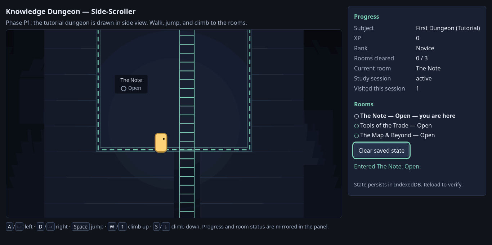

## P2 — Note loop

P2 re-ran the P1 dungeon path on the current build (frames `01`–`06`) and then drove the
note loop in a fresh save (frames `07`–`12`). The composer is a real DOM dialog over the
canvas; the artifact is plain text in a `<pre>`; no frame contains learner content.

### Composer opens from E


### Draft: the exact missing sections


### Cleared: XP and the plain-text artifact

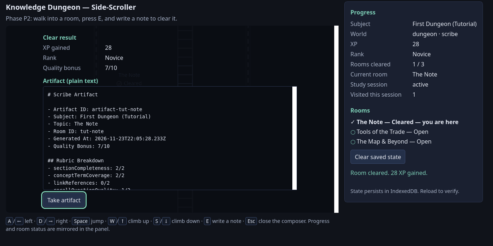

### Closed: focus back on the canvas


### Reload: cleared room, XP, and artifact survive

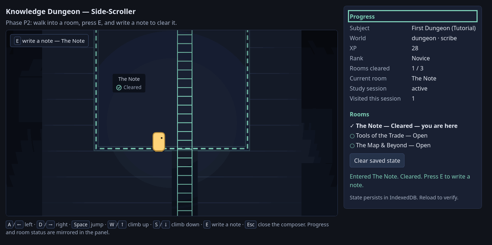

### Save failure: "Not saved", prior state intact

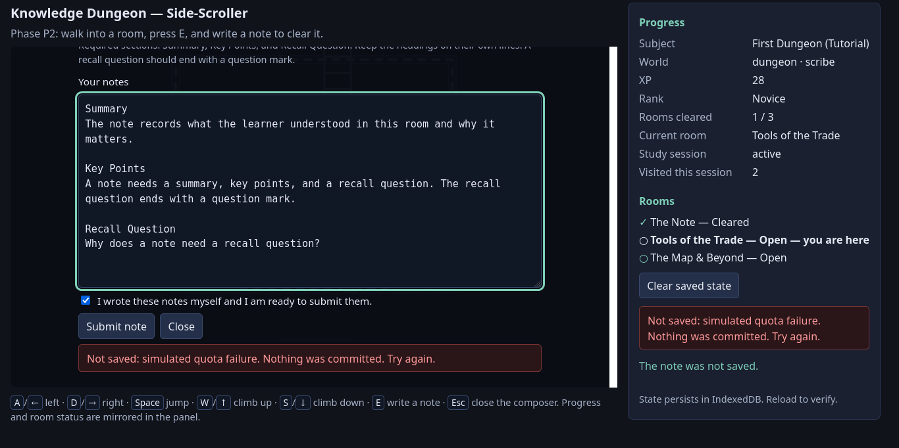

Manifest: [`2026-11-23-g2-manifest.json`](visuals/p2/2026-11-23-g2-manifest.json).

## P3 — Surface village

P3 adds the side-view street above the dungeon. Frame `01` is a fresh save with no
subject portals yet; `04` is the same street after the tutorial clear, with the engine's
subject portal row and the Training Grounds facade. These are the first P3 frames; the
[2026-11-24 follow-up](#follow-up-spacing-and-movement-fix-2026-11-24) fixes the facade
spacing and removes the portal/gate overlap.

### Village street (fresh save)

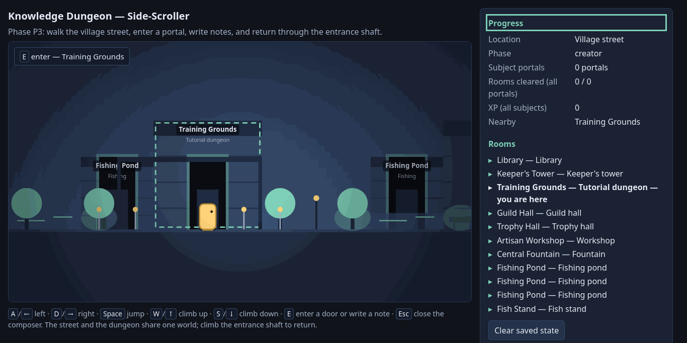

### Portal entry


### Room cleared


### Returned through the entrance shaft


### Reload on the street

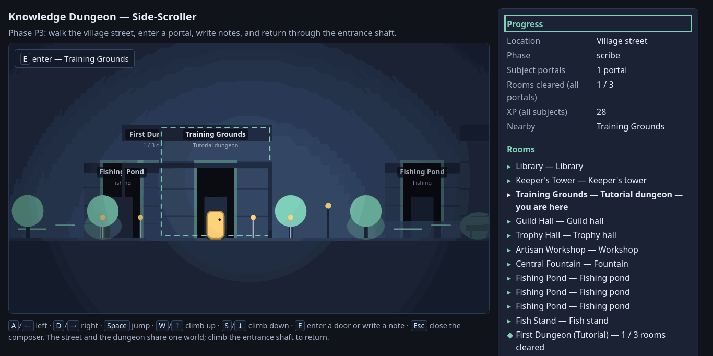

### Reload in the dungeon


Manifest: [`2026-11-23-g3-manifest.json`](visuals/p3/2026-11-23-g3-manifest.json).

### Follow-up: spacing and movement fix (2026-11-24)

Playtest feedback found two problems in the first P3 pass: the raw top-down `gridX`
values clumped facades together, and solid building bodies plus a door gap trapped the
player inside the Training Grounds footprint. The follow-up makes facades background
presentation, keeps only the street ground and invisible world edges as collision,
spaces buildings by 1.6× with a 3-tile minimum gap, and centres the spawn/entrance on
the Training Grounds door. The 2026-11-23 frames are retained as the earlier record.

#### Fixed street: buildings separated, player free to walk


#### Portal entry on the fixed street


#### Room cleared


#### Returned through the shaft

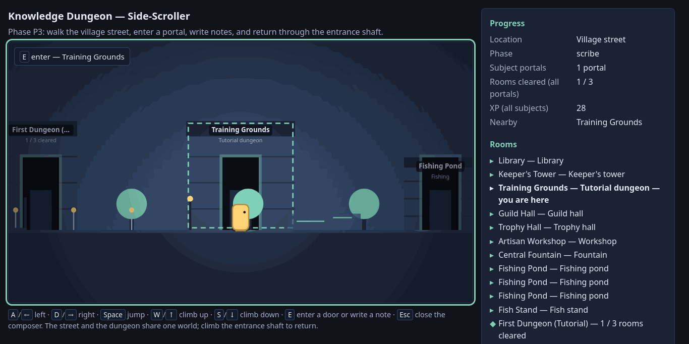

#### Reload on the street

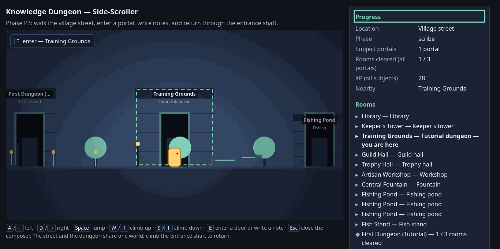

#### Reload in the dungeon

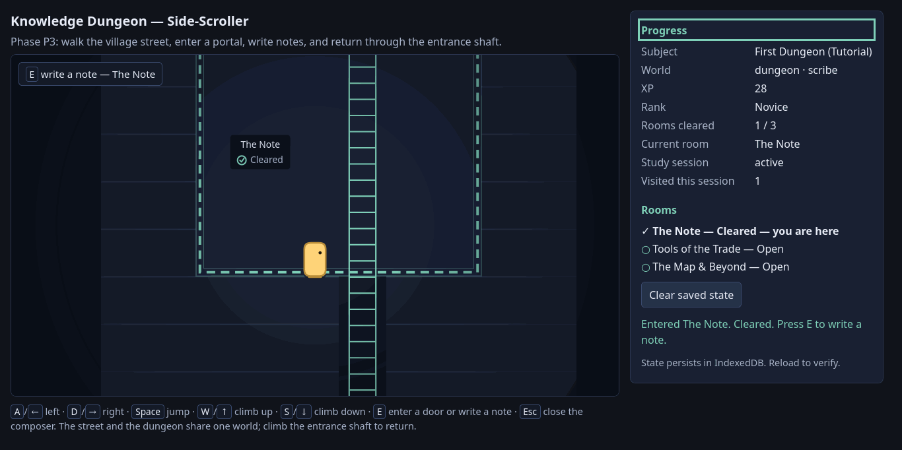

Manifest: [`2026-11-24-g3-manifest.json`](visuals/p3/2026-11-24-g3-manifest.json).

### Polish pass (2026-11-24)

The polish pass adds a deterministic skyline and moon, warm window lights, contact
shadows, door frames and steps, paving seams, a street gradient, and a small chevron at
the entrance shaft. Portal signs may extend into the 3-tile building gap so the subject
name stays readable, and the surface HUD drops redundant type repeats and labels the
three ponds by direction.

#### Polished street

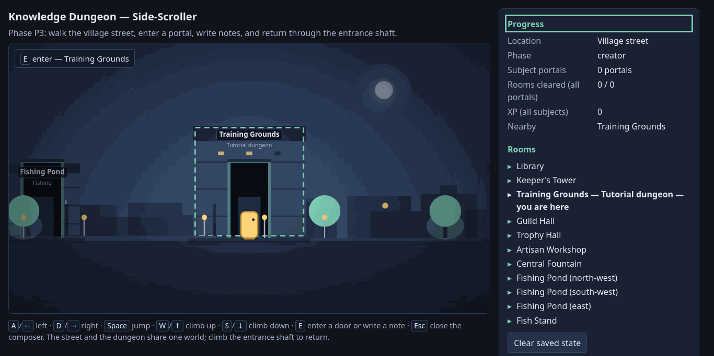

#### Portal entry


#### Room cleared


#### Returned through the shaft


#### Reload on the street


#### Reload in the dungeon


Manifest: [`2026-11-24-g3p-manifest.json`](visuals/p3/2026-11-24-g3p-manifest.json).

## P4 — Fishing

P4 adds the Fisher's Rest loop at the north-west surface pond. The capture clears one
tutorial room, walks to the pond, holds Space to cast, presses Space at the bite, keeps
with a correct recall (activated with Enter on the focused dialog button), releases a
second fish, reloads, and finally reloads mid-cast to prove the recovery notice.

This run enabled the OS reduced-motion preference (`ui.prefersReducedMotion=1`;
`matchMedia` true) and took a 10-second frame measurement at the pond: 596 frames,
average 16.79 ms, p95 17.16 ms, max 33.74 ms (one dropped frame), 319 frames just over 16.7 ms. That is the
headless software-compositing floor recorded as P2-O1, not a fishing-specific cost.
Tab order inside the recall dialog is `answered-incorrect → release → later →
answered-correct` (wrapping inside the modal).

### Pond on the street

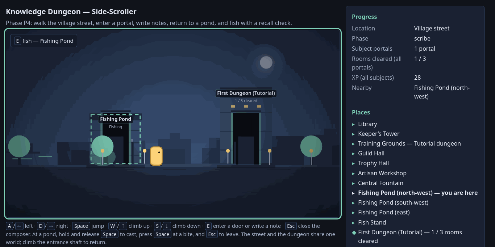

### Pond entry


### Charging the cast

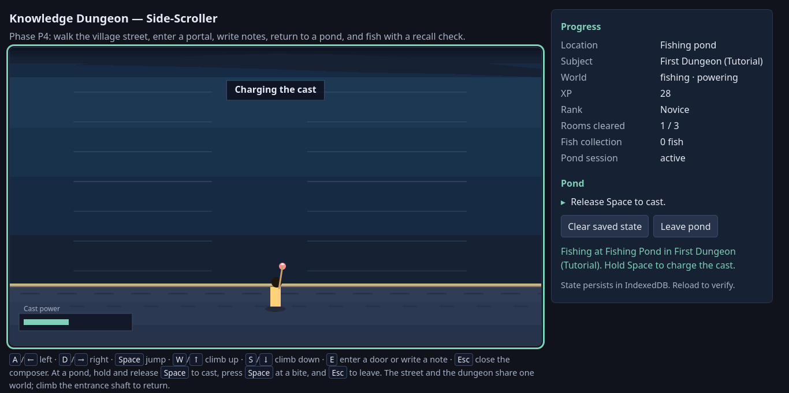

### Waiting for a bite


### Bite

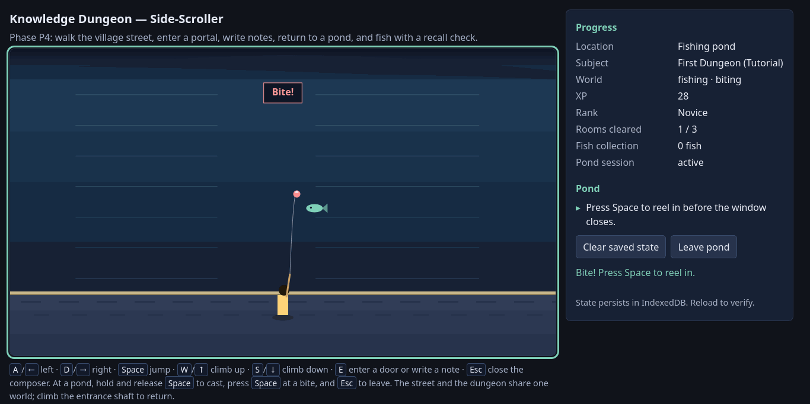

### Recall dialog

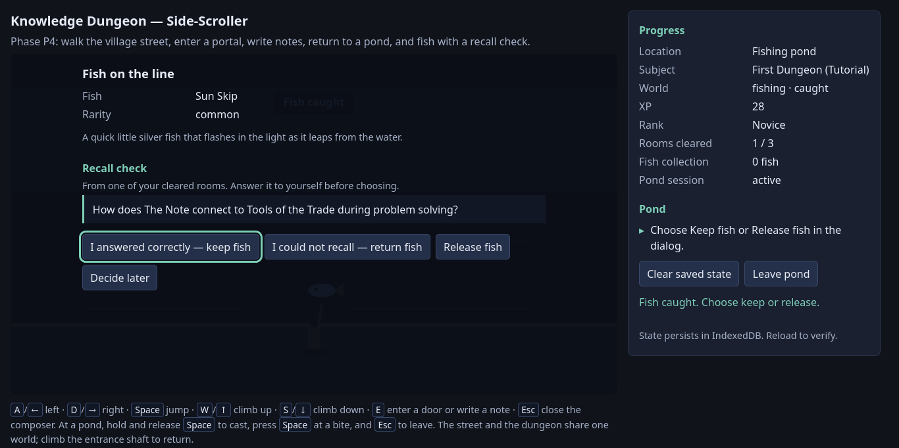

### Catch save failure


### Kept with recall

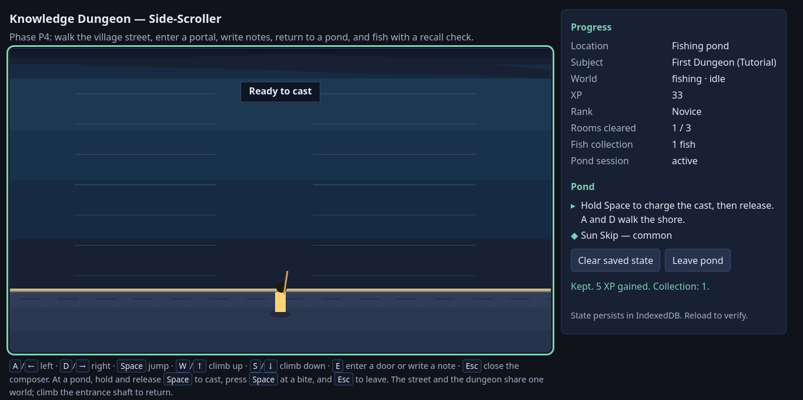

### Released


### Left the pond


### Reload after a catch

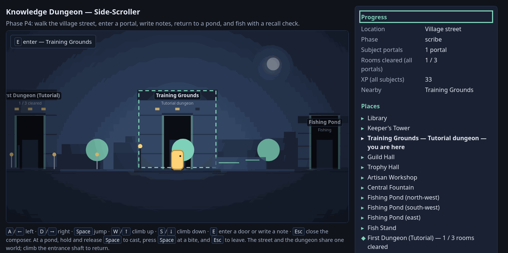

### Mid-cast reload recovery


Manifest: [`2026-11-24-g4-manifest.json`](visuals/p4/2026-11-24-g4-manifest.json).

### Follow-up: on-canvas interaction feedback (2026-11-24)

Playtest feedback: on a fresh save, pressing `E` at a pond appeared to do nothing,
and non-portal buildings also appeared inert. Both outcomes were only written to the
side panel, which sits below the canvas on narrow windows. The follow-up adds a canvas
toast for refusals and facade interactions. The full pond path was re-captured with the
same conditions under `g4b`; the two frames below show the changed feedback.

#### Pond before a clear: the refusal is on the canvas

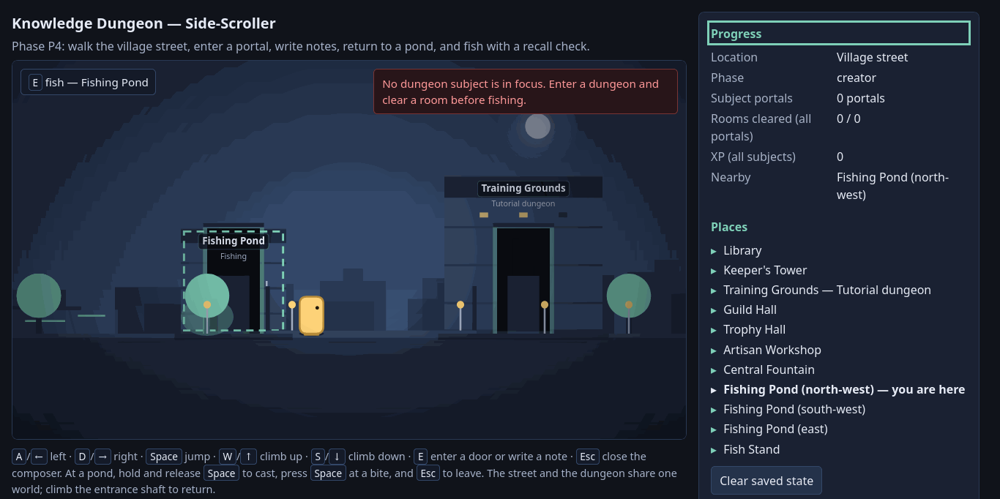

#### Non-portal building: says it has no interior


Manifest for the full follow-up run:
[`2026-11-24-g4b-manifest.json`](visuals/p4/2026-11-24-g4b-manifest.json).

## P5 — Archaeologist review

P5 adds the 0–5 recall review. The capture clears the three tutorial rooms, presses R before the unlock to show the engine refusal, rates a pass, saves a marker for later, reloads and resumes it, discards it, re-saves and completes the same pass to show the duplicate ledger, then breaks the IndexedDB write on a never-reviewed room. It finishes by climbing to the street and opening the queue with R, which activates the subject and must close it again. The keyboard path uses the real keys `0`–`5`, `Enter`, `S`, `D`, and `Escape`; `R` opens the panel from a room and from the street.

The first run is the normal visual; the second repeats the whole path with `ui.prefersReducedMotion=1`. The 10-second frame measurement with the panel open was 558 frames, average 17.93 ms, p95 33.24 ms, max 50.56 ms in the normal run, and 601 frames, average 16.64 ms, p95 17.18 ms, max 33.38 ms in the reduced-motion run. Both sit on the headless software-compositing floor recorded as P2-O1; the panel itself adds no per-frame work.

Manifests: [`2026-11-24-g5-manifest.json`](visuals/p5/2026-11-24-g5-manifest.json) and [`2026-11-24-g5rm-manifest.json`](visuals/p5/2026-11-24-g5rm-manifest.json).

### Review locked

Boot the tutorial, clear only the root room, and press R: the engine gate refuses because 1 of 3 encounters is cleared. The toast and the error region both say so and no panel opens.


### Cleared room prompt

All three rooms cleared; the room prompt now carries both `E write a note` and `R review`, and the HUD reports 3 rooms due and review mode unlocked.


### Review panel

The panel shows the room, pass, "Previous rating: None chosen yet", the engine self-check prompt (a text node), and six engine-labelled ratings. Focus starts on the first rating; Submit is disabled until a rating is chosen.


### Rating selected

Pressing 5 marks the rating button pressed with a non-colour cue (`aria-pressed`) and enables Submit.

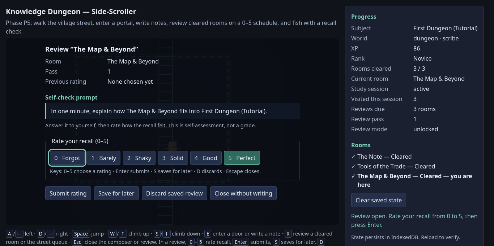

### Rated pass

Enter records the pass: XP, pass progress, and the next due date are visible without a reload. The HUD moves to 2 rooms due and keeps review mode unlocked.


### Saved for later

S saves the marker with rating 4 preselected; the copy names the saved timestamp, promises no XP, and the pass count does not move.


### Resumed after reload

After a reload, walking back and pressing R restores "Previous rating: 4 · Good" and preselects it; the live region says the saved review resumed.


### Saved review discarded

D arms a confirmation, the second D discards, and the copy says nothing was scheduled; the durable marker is gone.

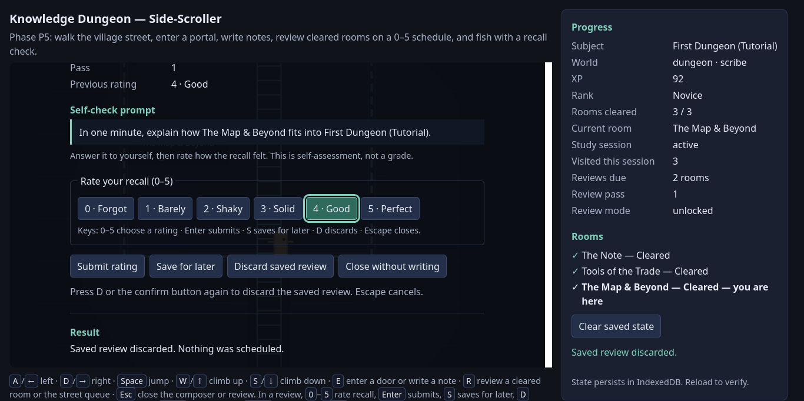

### Resumed completion is not paid twice

Resuming the re-saved marker and completing it hits the same (room, pass): XP and review passes stay at 92 and 1, and the copy discloses that the duplicate path left the marker in place.

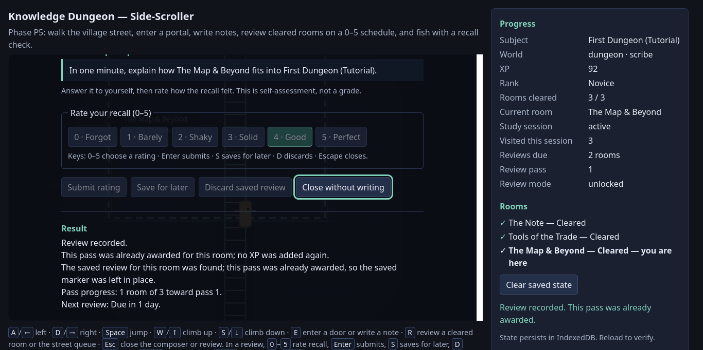

### Review save failure

A simulated quota failure on the lower room shows "Not saved … the review is still open" in the panel and the HUD; XP stays 92 and the lower room pass count stays 0.


### Reload after review work

The final reload keeps 3/3 cleared, one review pass on the upper room, a next review date, and no marker.


### Street review shortcut

Climbing back to the street and pressing R opens the queue for the last-studied subject: the host activates the subject for the command, the panel opens on the most urgent room, and the surface HUD stays visible.


### Street review closed

Escape closes the street review, returns focus to the canvas, and the host calls `returnToVillage()`: active subject null and no study session left open (K-15).


### Reduced-motion re-run (2026-11-24)

The whole path repeated with `matchMedia('(prefers-reduced-motion: reduce)')` true. Same frame names under the `g5rm` prefix; the panel itself has no transitions, and camera motion snaps.


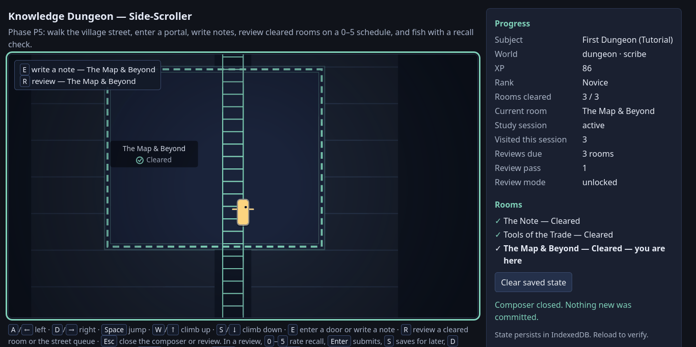


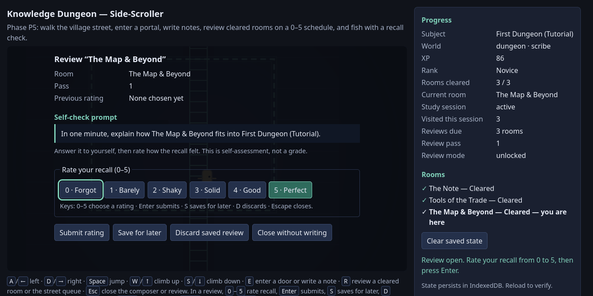

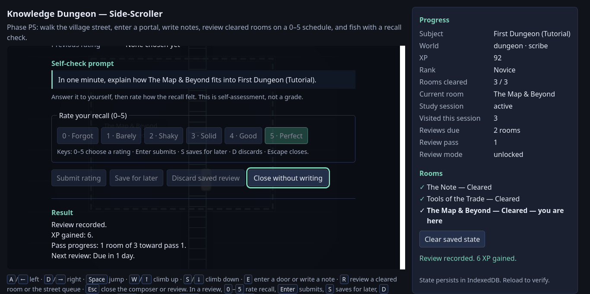


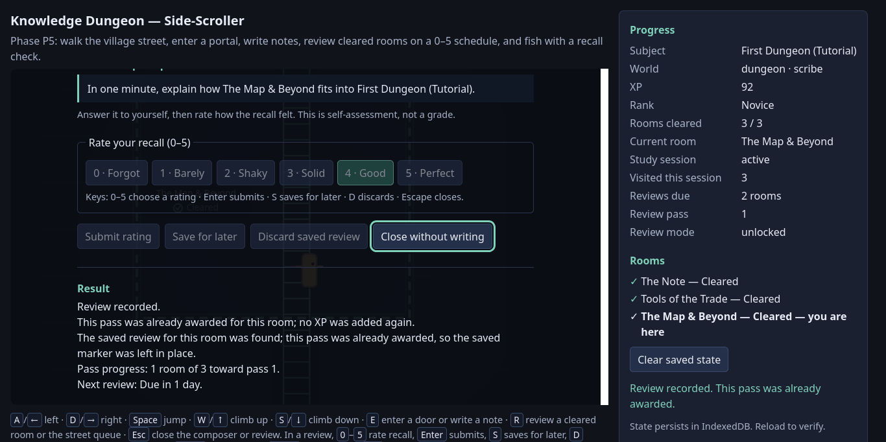

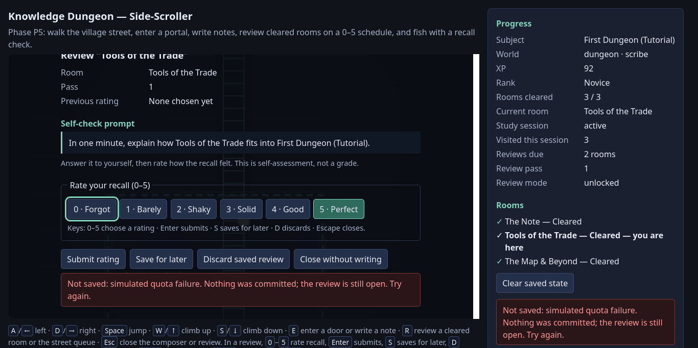


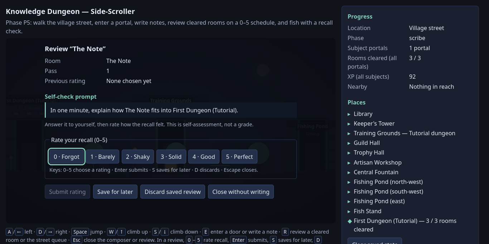

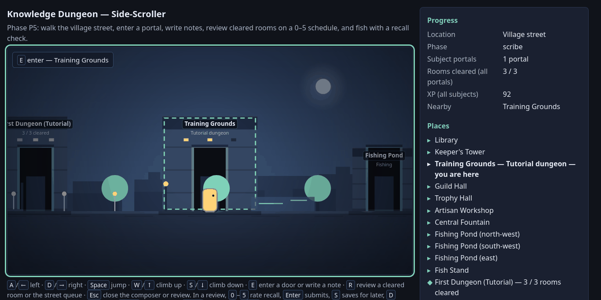

### Follow-up: one player figure (2026-11-24)

The P4 pond drew its own avatar — a rectangular torso with a separate circular
head and no eye — while the dungeon and the street drew the capsule figure. The
pond now calls the same `drawPlayerFigure` (`src/render/playerFigure.ts`) at the
world body size, so the character does not change when the learner walks from the
shore into a dungeon. The full `--fishing` run is kept under the `g5player`
prefix; the two frames below show the comparison.

#### Dungeon figure


#### Pond figure

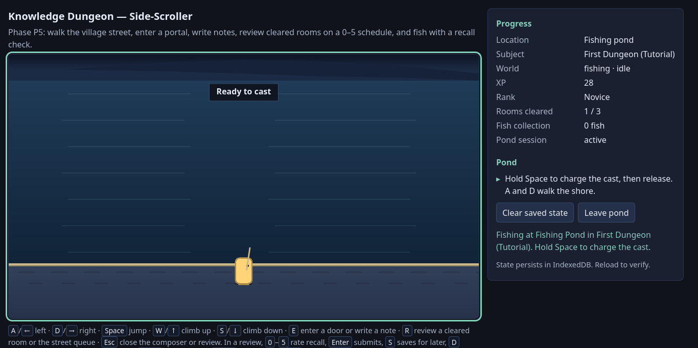

Manifest: [`2026-11-24-g5player-manifest.json`](visuals/p5/2026-11-24-g5player-manifest.json).

## P6 — Creator and demo campaign

A fresh profile seeds three synthetic subjects on the first boot. The run then uses `C`
(the host's street shortcut; the Guild Hall door opens the same overlay) to create a
fourth subject, build a nested tree, tag and cross-link rooms, and remove the subtree
through the two-step cascade confirmation. The demo subject names are authored content,
not learner data. Frames were reduced to 256-colour PNGs with the snippet at the end of
this file.

### Subject list on a seeded save


### Create a subject

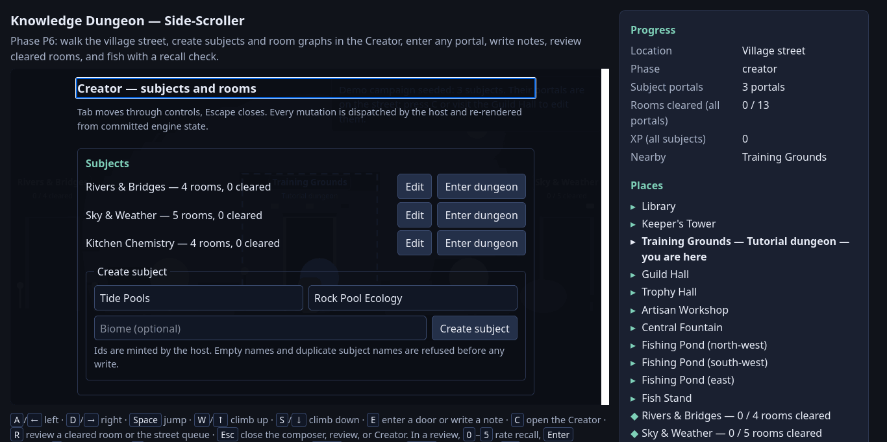

### The new subject's empty tree

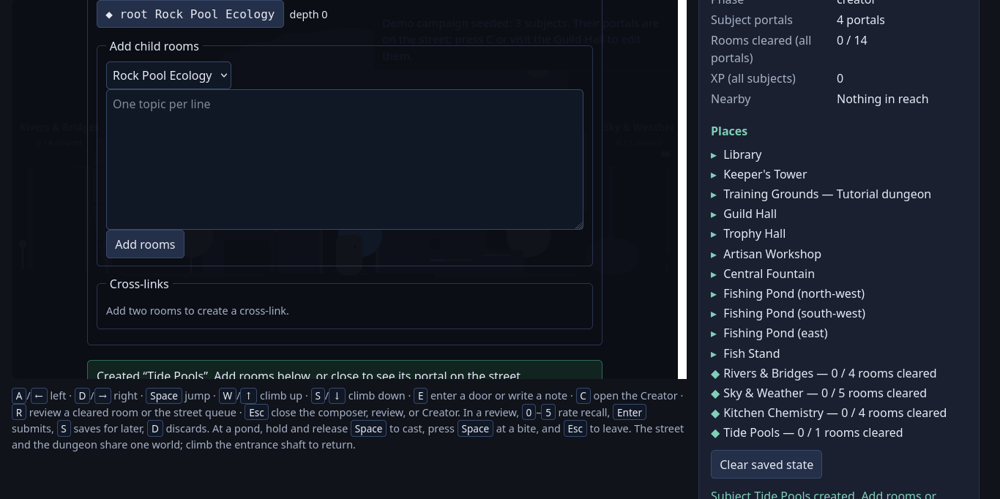

### Tree after adding root children

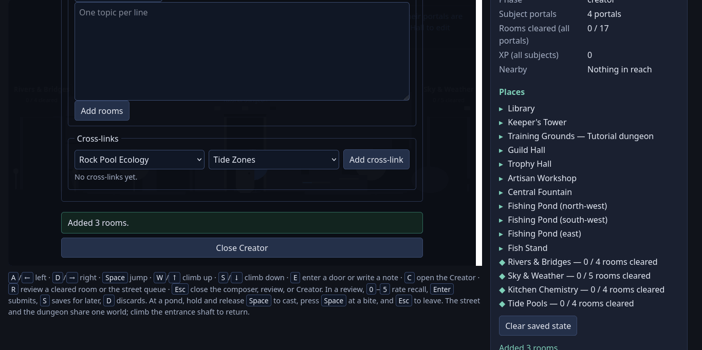

### Cascade confirmation names all three rooms


### Tags and a cross-link


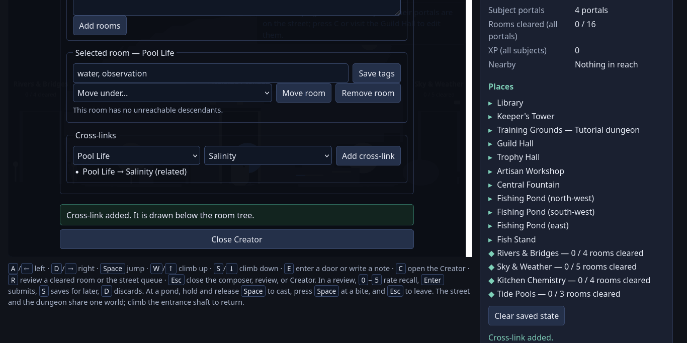

### The new portal on the street

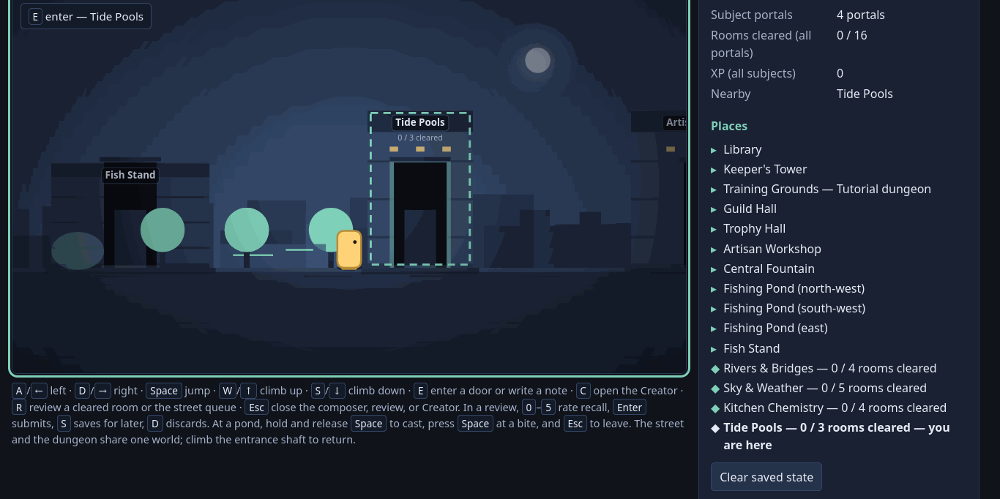

### Refusals are visible and non-destructive


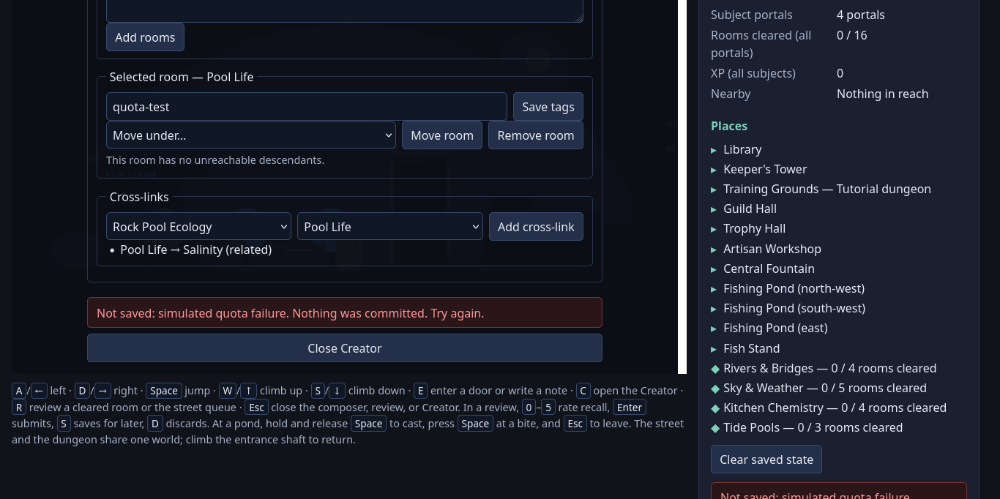

### Keyboard-only create, add rooms, and entry


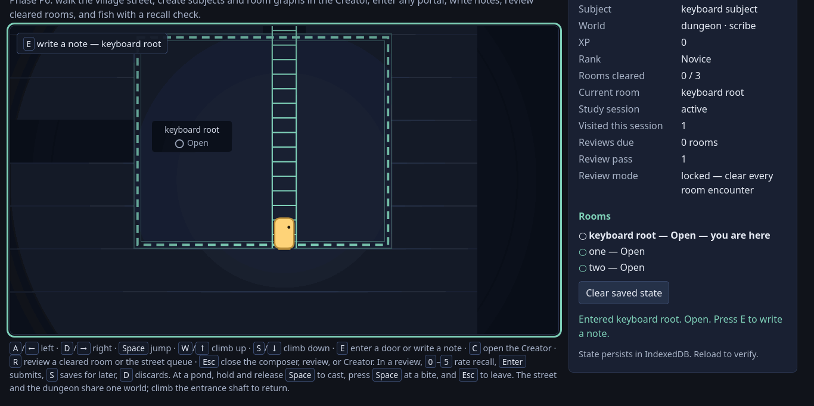

The keyboard segment used real WebDriver key events only: `C` opened the panel, Tab
reached the create form (9 tabs), typing filled name and root topic, Enter created,
Tab reached the topics textarea, Enter added two rooms, Escape closed and returned
focus to `#game`, then `D` walked to the new portal and `E` entered its dungeon.

### Reduced-motion run (2026-11-24)

`matchMedia('(prefers-reduced-motion: reduce)')` true, same seed. The Creator panel has
no animation; the underlying street camera snaps instead of easing.


Manifests: [`2026-11-24-g6-manifest.json`](visuals/p6/2026-11-24-g6-manifest.json),
[`2026-11-24-g6rm-manifest.json`](visuals/p6/2026-11-24-g6rm-manifest.json).

## Capturing the next phase

Prerequisites: example dependencies installed, Firefox on `PATH`, and `geckodriver`
available. The app must be reachable at the script's `--base` (default
`http://localhost:5174/`); if Vite reports another port because 5174 is busy, pass it
explicitly.

```sh
# terminal 1 — the app
npm --prefix examples/side-scroller run dev

# terminal 2 — WebDriver
geckodriver --port 4444

# terminal 3 — capture from the repository root
node examples/side-scroller/scripts/capture-dungeon.mjs \
  --out docs/plans/side-scroller-host/visuals/p2 \
  --prefix 2026-11-23-g2 \
  --low-fps --reduced-motion --note-loop
```

The script drives the real app over WebDriver:

1. reduced-motion session (when `--reduced-motion`);
2. start tutorial and the root frame;
3. optional main-thread hog and frame-interval measurement (`--low-fps`);
4. step off, ladder down, lower frame;
5. climb until the room actually changes, upper frame;
6. descend, step off, root frame;
7. reload and final frame;
8. writes `<prefix>-manifest.json` and prints Markdown rows for the index.

With `--note-loop`, a second session resets the save through the app's own control and
then captures: composer open, draft, clear, close/focus return, reload, and a simulated
storage failure (the next IndexedDB `put` throws). The script injects that failure through
`IDBObjectStore.prototype.put` in the page; the app has no test hooks and its normal
"not saved" path runs.

With `--surface`, a separate mode captures the P3 street and the portal/return loop:
street, Training Grounds entry, cleared room, shaft return, reload on the street, and
reload in the dungeon. It uses the same real app and key events; no test hooks are added.

```sh
node examples/side-scroller/scripts/capture-dungeon.mjs \
  --out docs/plans/side-scroller-host/visuals/p3 \
  --prefix 2026-11-23-g3 \
  --surface
```

With `--fishing`, a separate mode captures the pond loop: dungeon entry, a cleared room,
the walk to a pond, powering, waiting, the bite, the recall dialog, a simulated
IndexedDB failure on keep, the retry with Enter, a release, leaving the pond, reload, and
a mid-cast reload recovery. Add `--reduced-motion` to run it with the OS preference set.

```sh
node examples/side-scroller/scripts/capture-dungeon.mjs \
  --out docs/plans/side-scroller-host/visuals/p4 \
  --prefix 2026-11-24-g4 \
  --fishing --reduced-motion
```

It does not add test hooks to the page or change engine state beyond normal commands.
Use a new `--prefix` for every gate so the record stays append-only.

After capturing, reduce the PNGs if the sizes are large. P1 used Pillow's 256-colour
FASTOCTREE, which preserves the player and status colours:

```sh
python3 - <<'PY'
from PIL import Image
import glob, os
for path in glob.glob('docs/plans/side-scroller-host/visuals/p2/*.png'):
    image = Image.open(path).convert('RGB').quantize(colors=256, method=Image.FASTOCTREE)
    image.save(path, optimize=True)
PY
```

Then append the printed rows to the index, add the images to the gallery, and reference
the visual record from that phase's execution evidence.
