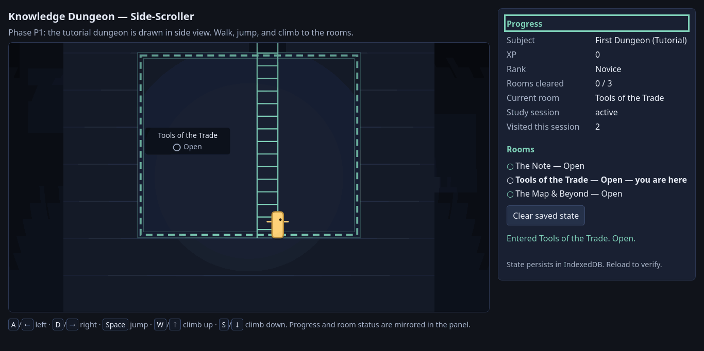
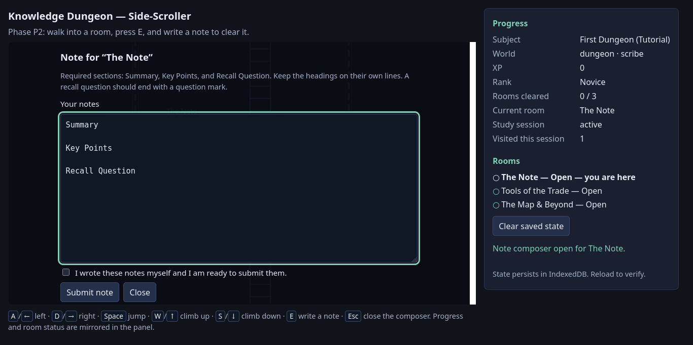
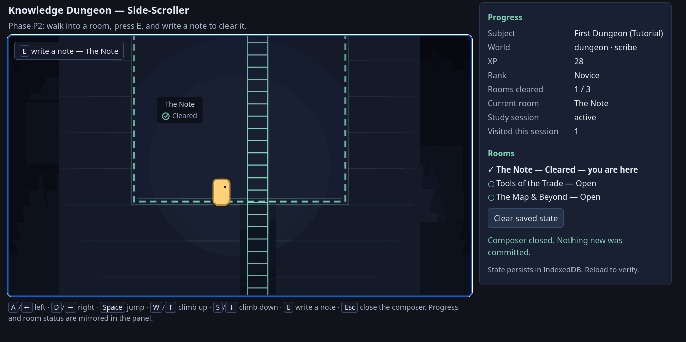
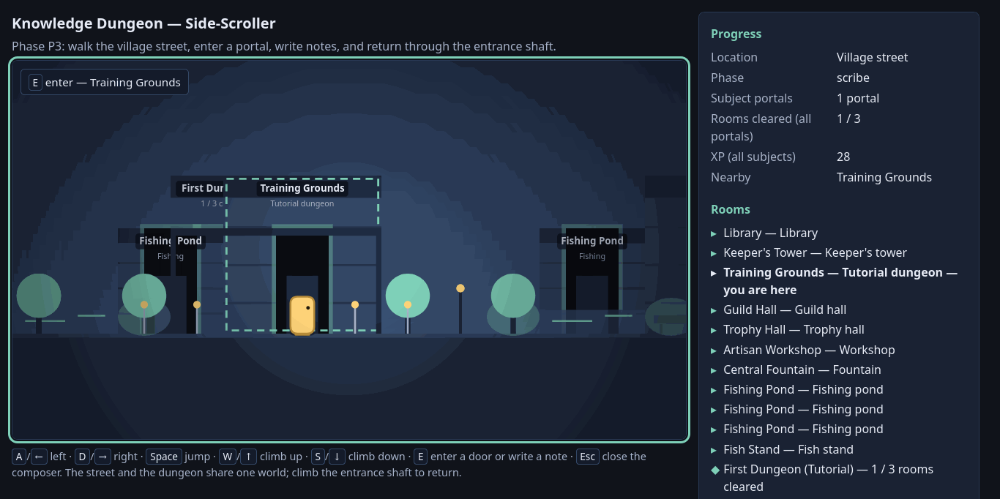
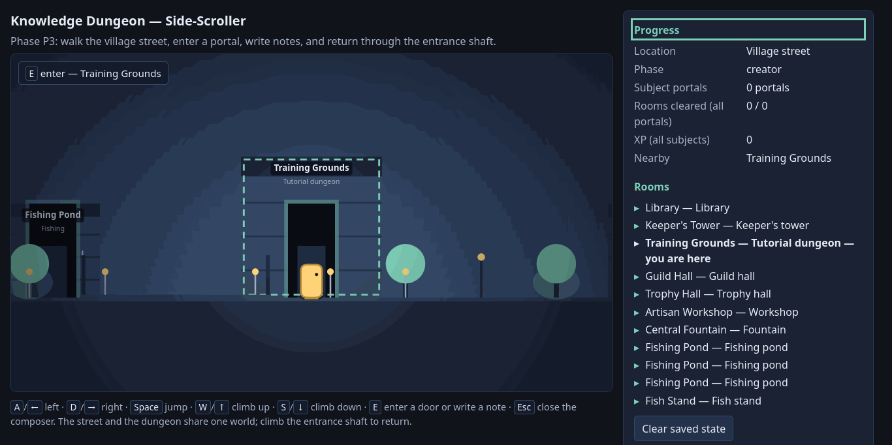
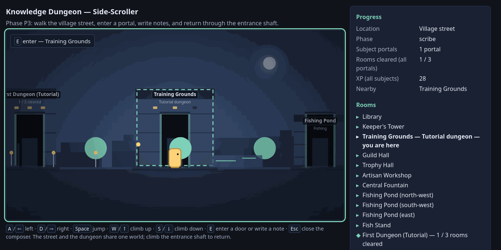

# Visual Record — Side-Scroller Host

Running, append-only visual history for [the implementation plan](README.md). The gate
evidence records *what passed*; this file records *what the host looked like* when it
passed.

## Rules

- **Append-only.** Never replace a gate's images. If a frame is wrong, capture a new dated
  frame and leave the old one in place with a note.
- **One folder per phase:** `visuals/p0/`, `visuals/p1/`, and so on.
- **File names:** `YYYY-MM-DD-gN-NN-slug.png`, where `NN` is the capture order. The
  capture script's `--prefix` produces exactly this pattern.
- **Content:** the full app window (canvas plus DOM HUD), tutorial fixture or synthetic
  data only. Never capture learner notes, topics, or subject names.
- **Every frame is dated and gated.** Record the commit (or `uncommitted`), the viewport,
  and the conditions that matter (low FPS, reduced motion, reload).
- **Keep the manifest.** Each gate gets a `<prefix>-manifest.json` beside its images,
  produced by the capture script and annotated with the gate facts.
- **Keep the repository light.** P1 frames were reduced to 256-colour PNGs (~30 KiB each).

## Index

| Date | Gate | Commit | Frame | File | What it shows |
|---|---|---|---|---|---|
| 2026-11-23 | G1 | uncommitted (base `989acf1`) | Root room | [`01-root-room.png`](visuals/p1/2026-11-23-g1-01-root-room.png) | Start; spawn in `tut-note`; XP 0; 0/3 cleared; visits 1 |
| 2026-11-23 | G1 | uncommitted | Lower room | [`02-tools-room-low-fps.png`](visuals/p1/2026-11-23-g1-02-tools-room-low-fps.png) | Ladder descent under a 55 ms/80 ms main-thread hog; visits 2; frames avg 37 ms, max 67 ms |
| 2026-11-23 | G1 | uncommitted | Upper room | [`03-map-room.png`](visuals/p1/2026-11-23-g1-03-map-room.png) | Climb ≈3.8 s; visits 3; label clear of the ladder |
| 2026-11-23 | G1 | uncommitted | Return to root | [`04-return-to-root.png`](visuals/p1/2026-11-23-g1-04-return-to-root.png) | Descend ≈1.1 s and step off; visits stays 3 (engine keeps a set) |
| 2026-11-23 | G1 | uncommitted | Reload | [`05-reload.png`](visuals/p1/2026-11-23-g1-05-reload.png) | Three rooms restored from IndexedDB; sessions 1 → 2; fresh session visits 1 |
| 2026-11-23 | G1 | uncommitted | Reduced motion | [`06-reduced-motion.png`](visuals/p1/2026-11-23-g1-06-reduced-motion.png) | `ui.prefersReducedMotion=1`; `matchMedia` true; camera snaps |
| 2026-11-23 | G2 | uncommitted (base `f0eda0e`) | Reduced motion | [`06-reduced-motion.png`](visuals/p2/2026-11-23-g2-06-reduced-motion.png) | P2 build; `matchMedia` true; no panel transitions; focus on the Progress heading |
| 2026-11-23 | G2 | uncommitted | Dungeon re-run: root | [`01-root-room.png`](visuals/p2/2026-11-23-g2-01-root-room.png) | P2 build; visits 1; P1 traversal unchanged |
| 2026-11-23 | G2 | uncommitted | Dungeon re-run: lower room | [`02-tools-room-low-fps.png`](visuals/p2/2026-11-23-g2-02-tools-room-low-fps.png) | Deliberate 55 ms/80 ms hog; visits 2; frames avg 41 ms, max 67 ms |
| 2026-11-23 | G2 | uncommitted | Dungeon re-run: upper room | [`03-map-room.png`](visuals/p2/2026-11-23-g2-03-map-room.png) | Climb ≈3.6 s; visits 3 |
| 2026-11-23 | G2 | uncommitted | Dungeon re-run: return | [`04-return-to-root.png`](visuals/p2/2026-11-23-g2-04-return-to-root.png) | Descend ≈1.1 s; visits stays 3 |
| 2026-11-23 | G2 | uncommitted | Dungeon re-run: reload | [`05-reload.png`](visuals/p2/2026-11-23-g2-05-reload.png) | Three rooms restored; fresh session visits 1 |
| 2026-11-23 | G2 | uncommitted | Composer | [`07-composer.png`](visuals/p2/2026-11-23-g2-07-composer.png) | `E` opens; template prefilled; focus in `#note-text`; prompt hidden while open |
| 2026-11-23 | G2 | uncommitted | Draft | [`08-draft.png`](visuals/p2/2026-11-23-g2-08-draft.png) | Missing sections named (`Key Points, Recall Question`); XP 0; cleared 0 |
| 2026-11-23 | G2 | uncommitted | Cleared | [`09-cleared.png`](visuals/p2/2026-11-23-g2-09-cleared.png) | 28 XP; room `Cleared`; artifact plain text in `<pre>`; focus on Take artifact |
| 2026-11-23 | G2 | uncommitted | Composer closed | [`10-closed.png`](visuals/p2/2026-11-23-g2-10-closed.png) | `Escape` closes; focus returns to `#game`; artifact count 1 |
| 2026-11-23 | G2 | uncommitted | Reload after clear | [`11-reload.png`](visuals/p2/2026-11-23-g2-11-reload.png) | XP 28, cleared 1, artifact 1 survive IndexedDB |
| 2026-11-23 | G2 | uncommitted | Save failure | [`12-not-saved.png`](visuals/p2/2026-11-23-g2-12-not-saved.png) | Simulated quota failure; "Not saved" in panel and HUD; XP 28→28, cleared 1→1 |
| 2026-11-23 | G3 | uncommitted (base `fd8c171`) | Village street | [`01-street.png`](visuals/p3/2026-11-23-g3-01-street.png) | Fresh save; 0 subject portals; nearby Training Grounds; prompt visible; canvas focus outline |
| 2026-11-23 | G3 | uncommitted | Portal entry | [`02-dungeon-entry.png`](visuals/p3/2026-11-23-g3-02-dungeon-entry.png) | Training gate enters in 16 ms; world dungeon; 3 rooms; active session |
| 2026-11-23 | G3 | uncommitted | Room cleared | [`03-cleared.png`](visuals/p3/2026-11-23-g3-03-cleared.png) | 28 XP; room `Cleared`; artifact outcome; active session |
| 2026-11-23 | G3 | uncommitted | Returned through the shaft | [`04-returned.png`](visuals/p3/2026-11-23-g3-04-returned.png) | Climb ≈4.0 s; world village; active subject null; session closed; subject portal row shows 1/3 |
| 2026-11-23 | G3 | uncommitted | Reload on the street | [`05-reload-surface.png`](visuals/p3/2026-11-23-g3-05-reload-surface.png) | World village; one subject portal; cleared count survives |
| 2026-11-23 | G3 | uncommitted | Reload in the dungeon | [`06-reload-dungeon.png`](visuals/p3/2026-11-23-g3-06-reload-dungeon.png) | P0-T5 recovery; world dungeon; 3 rooms; active session |
| 2026-11-24 | G3 re-run | uncommitted (base `b44f24a`) | Village street (fixed layout) | [`01-street.png`](visuals/p3/2026-11-24-g3-01-street.png) | Facades are background-only; 3-tile building gap; spawn centred on the Training Grounds door; player can walk both ways |
| 2026-11-24 | G3 re-run | uncommitted | Portal entry | [`02-dungeon-entry.png`](visuals/p3/2026-11-24-g3-02-dungeon-entry.png) | Training gate enters in 21 ms; world dungeon; 3 rooms; active session |
| 2026-11-24 | G3 re-run | uncommitted | Room cleared | [`03-cleared.png`](visuals/p3/2026-11-24-g3-03-cleared.png) | 28 XP; room `Cleared`; active session |
| 2026-11-24 | G3 re-run | uncommitted | Returned through the shaft | [`04-returned.png`](visuals/p3/2026-11-24-g3-04-returned.png) | Climb ≈4.0 s; world village; session closed; portal row shows 1/3 |
| 2026-11-24 | G3 re-run | uncommitted | Reload on the street | [`05-reload-surface.png`](visuals/p3/2026-11-24-g3-05-reload-surface.png) | World village; one subject portal; cleared count survives |
| 2026-11-24 | G3 re-run | uncommitted | Reload in the dungeon | [`06-reload-dungeon.png`](visuals/p3/2026-11-24-g3-06-reload-dungeon.png) | P0-T5 recovery; world dungeon; 3 rooms; active session |
| 2026-11-24 | G3 polish | uncommitted (base `1ef03cf`) | Village street (polished) | [`01-street.png`](visuals/p3/2026-11-24-g3p-01-street.png) | Skyline, moon, lit windows, contact shadows, paving; HUD deduped with pond locations |
| 2026-11-24 | G3 polish | uncommitted | Portal entry | [`02-dungeon-entry.png`](visuals/p3/2026-11-24-g3p-02-dungeon-entry.png) | Training gate enters in 72 ms; world dungeon; 3 rooms |
| 2026-11-24 | G3 polish | uncommitted | Room cleared | [`03-cleared.png`](visuals/p3/2026-11-24-g3p-03-cleared.png) | 28 XP; room `Cleared`; active session |
| 2026-11-24 | G3 polish | uncommitted | Returned through the shaft | [`04-returned.png`](visuals/p3/2026-11-24-g3p-04-returned.png) | Climb ≈4.2 s; full portal sign; world village; session closed |
| 2026-11-24 | G3 polish | uncommitted | Reload on the street | [`05-reload-surface.png`](visuals/p3/2026-11-24-g3p-05-reload-surface.png) | World village; one subject portal; cleared count survives |
| 2026-11-24 | G3 polish | uncommitted | Reload in the dungeon | [`06-reload-dungeon.png`](visuals/p3/2026-11-24-g3p-06-reload-dungeon.png) | P0-T5 recovery; world dungeon; 3 rooms; active session |

Manifests: [`2026-11-23-g1-manifest.json`](visuals/p1/2026-11-23-g1-manifest.json),
[`2026-11-23-g2-manifest.json`](visuals/p2/2026-11-23-g2-manifest.json),
[`2026-11-23-g3-manifest.json`](visuals/p3/2026-11-23-g3-manifest.json),
[`2026-11-24-g3-manifest.json`](visuals/p3/2026-11-24-g3-manifest.json),
[`2026-11-24-g3p-manifest.json`](visuals/p3/2026-11-24-g3p-manifest.json).

P0 predates this record: it proved boot and storage with a debug panel and captured no
frames. The record starts at P1.

## P1 — Dungeon level and movement

The tutorial generates as a vertical stack: `tut-note` at the root, `tut-tools` below,
`tut-map` above, joined by one ladder shaft at the room centre.

The teal outline on the Progress heading is the keyboard focus target after Start; the
start button is hidden once the dungeon opens.

### Start in the root room


### Lower room under low FPS



### Upper room after the climb


### Back in the root room


### After reload


### Reduced motion


## P2 — Note loop

P2 re-ran the P1 dungeon path on the current build (frames `01`–`06`) and then drove the
note loop in a fresh save (frames `07`–`12`). The composer is a real DOM dialog over the
canvas; the artifact is plain text in a `<pre>`; no frame contains learner content.

### Composer opens from E



### Draft: the exact missing sections


### Cleared: XP and the plain-text artifact


### Closed: focus back on the canvas



### Reload: cleared room, XP, and artifact survive


### Save failure: "Not saved", prior state intact


Manifest: [`2026-11-23-g2-manifest.json`](visuals/p2/2026-11-23-g2-manifest.json).

## P3 — Surface village

P3 adds the side-view street above the dungeon. Frame `01` is a fresh save with no
subject portals yet; `04` is the same street after the tutorial clear, with the engine's
subject portal row and the Training Grounds facade. These are the first P3 frames; the
[2026-11-24 follow-up](#follow-up-spacing-and-movement-fix-2026-11-24) fixes the facade
spacing and removes the portal/gate overlap.

### Village street (fresh save)


### Portal entry


### Room cleared


### Returned through the entrance shaft



### Reload on the street


### Reload in the dungeon


Manifest: [`2026-11-23-g3-manifest.json`](visuals/p3/2026-11-23-g3-manifest.json).

### Follow-up: spacing and movement fix (2026-11-24)

Playtest feedback found two problems in the first P3 pass: the raw top-down `gridX`
values clumped facades together, and solid building bodies plus a door gap trapped the
player inside the Training Grounds footprint. The follow-up makes facades background
presentation, keeps only the street ground and invisible world edges as collision,
spaces buildings by 1.6× with a 3-tile minimum gap, and centres the spawn/entrance on
the Training Grounds door. The 2026-11-23 frames are retained as the earlier record.

#### Fixed street: buildings separated, player free to walk



#### Portal entry on the fixed street


#### Room cleared


#### Returned through the shaft


#### Reload on the street


#### Reload in the dungeon


Manifest: [`2026-11-24-g3-manifest.json`](visuals/p3/2026-11-24-g3-manifest.json).

### Polish pass (2026-11-24)

The polish pass adds a deterministic skyline and moon, warm window lights, contact
shadows, door frames and steps, paving seams, a street gradient, and a small chevron at
the entrance shaft. Portal signs may extend into the 3-tile building gap so the subject
name stays readable, and the surface HUD drops redundant type repeats and labels the
three ponds by direction.

#### Polished street


#### Portal entry


#### Room cleared


#### Returned through the shaft



#### Reload on the street


#### Reload in the dungeon


Manifest: [`2026-11-24-g3p-manifest.json`](visuals/p3/2026-11-24-g3p-manifest.json).

## Capturing the next phase

Prerequisites: example dependencies installed, Firefox on `PATH`, and `geckodriver`
available. The app must be reachable at the script's `--base` (default
`http://localhost:5174/`); if Vite reports another port because 5174 is busy, pass it
explicitly.

```sh
# terminal 1 — the app
npm --prefix examples/side-scroller run dev

# terminal 2 — WebDriver
geckodriver --port 4444

# terminal 3 — capture from the repository root
node examples/side-scroller/scripts/capture-dungeon.mjs \
  --out docs/plans/side-scroller-host/visuals/p2 \
  --prefix 2026-11-23-g2 \
  --low-fps --reduced-motion --note-loop
```

The script drives the real app over WebDriver:

1. reduced-motion session (when `--reduced-motion`);
2. start tutorial and the root frame;
3. optional main-thread hog and frame-interval measurement (`--low-fps`);
4. step off, ladder down, lower frame;
5. climb until the room actually changes, upper frame;
6. descend, step off, root frame;
7. reload and final frame;
8. writes `<prefix>-manifest.json` and prints Markdown rows for the index.

With `--note-loop`, a second session resets the save through the app's own control and
then captures: composer open, draft, clear, close/focus return, reload, and a simulated
storage failure (the next IndexedDB `put` throws). The script injects that failure through
`IDBObjectStore.prototype.put` in the page; the app has no test hooks and its normal
"not saved" path runs.

With `--surface`, a separate mode captures the P3 street and the portal/return loop:
street, Training Grounds entry, cleared room, shaft return, reload on the street, and
reload in the dungeon. It uses the same real app and key events; no test hooks are added.

```sh
node examples/side-scroller/scripts/capture-dungeon.mjs \
  --out docs/plans/side-scroller-host/visuals/p3 \
  --prefix 2026-11-23-g3 \
  --surface
```

It does not add test hooks to the page or change engine state beyond normal commands.
Use a new `--prefix` for every gate so the record stays append-only.

After capturing, reduce the PNGs if the sizes are large. P1 used Pillow's 256-colour
FASTOCTREE, which preserves the player and status colours:

```sh
python3 - <<'PY'
from PIL import Image
import glob, os
for path in glob.glob('docs/plans/side-scroller-host/visuals/p2/*.png'):
    image = Image.open(path).convert('RGB').quantize(colors=256, method=Image.FASTOCTREE)
    image.save(path, optimize=True)
PY
```

Then append the printed rows to the index, add the images to the gallery, and reference
the visual record from that phase's execution evidence.
